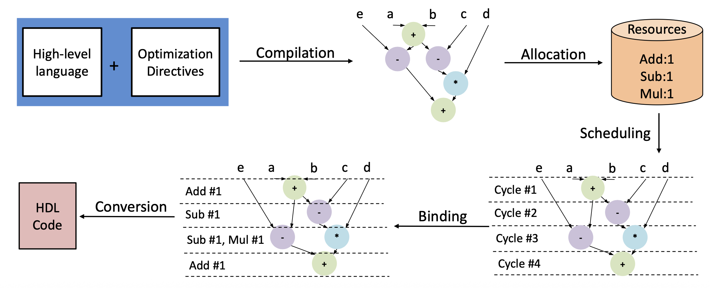

# CADL 新手教程

从你已经运行成功的 `hello.cadl` 开始，逐步读懂寄存器、整数、循环、数组、数据搬运和 GEMM。你不需要先学会 MLIR、Verilog 或编译器原理；每遇到一个新概念，我们先用小例子说明，再看它如何出现在 GEMM 中。

章节组织参考[菜鸟 Python3 教程](https://www.runoob.com/python3/python3-tutorial.html)的“简介、基础语法、实例、练习”方式，内容为针对 APS 的独立讲解。它不是菜鸟教程官方课程。

## 00 为什么需要 CADL

**CADL 要解决的问题是：怎样用较容易编写的方式，描述一条自定义指令的计算、存储和 CPU 交互，再让工具生成相应硬件。** 学它之前，先理解我们为什么想增加一条指令，以及“增加指令”到底多了哪些工作。

本节依据 `aps-synth.pptx` 第 1～8 页及演讲者备注展开，并结合第 9 页的 CADL 定义。课件页脚日期为 2026 年 1 月 17 日。它解释设计动机；本教程收录的 float 源码快照说明具体版本能力，两者用途不同。[逐页正文与备注](参考资料/aps-synth/逐页正文与备注.md)

### 先从你的 SmolVLA 实验想起

你已经可以用现有程序计算 GEMM，所以问题不是“矩阵乘法能不能算出来”。你真正关心的是：**同样的计算，能否在目标处理器上更快完成，且把数据准备和搬运也算进去后仍然有收益。**

例如一个点积需要反复读取 A、B 的元素、相乘、累加。通用 CPU 可以完成这些工作，但它执行的是已有指令和已有硬件支持的操作。针对经常出现的计算，我们可以考虑设计专用硬件，让它用适合该计算的运算单元连接和存储方式工作，再提供一条或一组指令，让 CPU 调用它。

这只是优化方向，不保证一定更快：命令、搬运、打包和等待都有成本。你后面的 baseline 与 CADL 对照实验，就是在检验这笔成本是否值得。

### 指令 ISA ISAX ASIP 分别是什么

| 词 | 先这样理解 | 与本实验的关系 |
|---|---|---|
| 指令 | CPU 能识别并执行的一种规定动作，例如加法或读内存 | C 程序最终要编译成目标 CPU 能执行的指令 |
| ISA | 指令集架构，规定有哪些指令及它们的可见行为 | RISC-V 是你目前使用的目标指令体系 |
| ISAX | 指令集扩展，给原有指令体系增加特定操作 | 例如约定一条自定义指令调用一个 GEMM tile（矩阵小块）的计算 |
| ASIP | 面向特定应用设计或定制的处理器 | 根据任务需要选择、扩展处理器能力 |
| RTL | 描述寄存器、组合逻辑和时钟等硬件行为的层次 | 手写 Verilog 或生成 Verilog 都会涉及它 |

时钟周期可以先理解为硬件推进工作的一个节拍。一条普通加法指令能完成的工作很小。一条自定义指令也可以触发多周期的复杂行为。**一条指令不等于一个周期**，也不表示矩阵里的所有元素一次放进寄存器。

### 第 4 页 为什么直接写硬件会比较难

假设你说“我想做一个 8×8 的矩阵乘法器”。数学公式已经明确，但实现硬件还要回答：

- 乘法器和加法器用多少个，哪些运算能同时进行？
- 数据存在哪里，每个周期能读多少个数？
- CPU 怎样发起这次计算，参数怎样传进去？
- 内存暂时没有响应时怎么办，什么时候向 CPU 返回完成？
- 前一周期的中间结果如何保存到后一周期？

用 RTL 开发时，设计者需要处理大量这样的细节。课件第 4 页备注指出，即便使用 Chisel、Chipyard 等提高组织效率的工具，采用 RTL 路线仍需要硬件知识。这里不是说这些工具不好，而是说明“能写计算公式”和“能实现可用电路”之间还有工作量。

课件把已有路线分为 RTL、商用高层工具和学术工具，并提出 APS 希望同时做到代码可获取和扩展、开发较灵活、能表达复杂优化。这是作者当时的设计目标与比较角度，不应据此断言所有其他工具现在都缺乏某项能力。

### 第 7 页 更难的地方是 CPU 与新硬件怎样配合

**会计算，还不等于 CPU 能调用。** 就像做出一台矩阵计算设备之后，仍需规定如何交任务、给数据和收结果。

课件第 7 页说明了三种差异：

| 差异来自哪里 | 具体会变什么 | 为什么影响开发 |
|---|---|---|
| 基础处理器不同 | 流水线、访存接口等微架构不同 | 同一个计算模块不能假设所有 CPU 都以同样方式交付数据 |
| 新硬件放的位置不同 | 接入执行阶段的功能单元、协处理器、较独立的加速器 | 调用和返回的组织方式可能不同 |
| 接口协议不同 | 例如 RoCC、CV-X-IF | 命令、操作数、响应及约束需要按具体接口处理 |

这里的功能单元可以理解为 CPU 执行部分里的一块专用算术电路；协处理器是配合 CPU 工作的专用单元；较独立的加速器通常处理更大块的工作。它们的界限和具体能力取决于实现，不必把这些名称当成固定性能等级。

如果把计算逻辑与某一种接口的所有信号紧紧写在一起，更换处理器时就容易连计算控制代码一起修改。因此，课件提出：先用一套共同的语义表达“CPU 与扩展硬件之间需要发生哪些交互”，再由适配器映射到具体平台。

### 第 8 页 APS-Itfc 把交互整理成几种可理解的动作

这里的 transaction 可以先理解为“一次有明确含义的接口交互”，不要联想到数据库里的自动回滚或整块矩阵原子更新。

| APS-Itfc 名称 | 通俗解释 | 做 GEMM 时可能对应什么 |
|---|---|---|
| Issue Req | 收到一项新的自定义指令任务 | CPU 要求加载或计算 |
| GPR Req | 接收来自源寄存器的操作数 | 拿到地址、tile 编号或控制标志 |
| Rd/WrMem Req | 提出一次内存读写请求，与块访问相区分 | 读取一个数、写回一个数 |
| Rd/WrMem Resp | 收到那次内存访问的响应 | 读取的数据到达，或按协议得到写应答 |
| Rd/WrBlkMem Req | 提出一块数据的读写请求 | 要求把矩阵块搬入或搬出 |
| Rd/WrBlkMem Resp | 收到块访问的响应 | 按协议接收块数据或搬运应答 |
| Result Resp | 向 CPU 返回该指令的结果或应答 | 最小 add 返回标量，当前 GEMM 返回完成应答 |

请求和响应分开，是因为内存和运算都可能需要等待。“我要这份数据”与“数据已经可以使用”是两个事件。第 31 节的握手就是进一步解释两边如何确认交接。

这套抽象描述的是共同含义，不要求每一项都在物理上变成一条独立连线或额外一个周期。例如 RoCC 命令可以同时携带指令信息和源操作数；后端仍需按具体平台正确实现。

### 第 9 页 CADL 把计算与这些交互放在同一份描述中

APS-Itfc 回答“接口交互有哪些含义”；CADL 提供表达这些含义及其他行为的语言；APS 则是完成解析、优化、调度和硬件生成的一套工具。

```text
你用 CADL 描述
    指令编码、操作数、存储、计算、循环、优化要求
                    ↓
APS 使用接口抽象和编译流程
                    ↓
生成能与目标处理器配合工作的硬件描述
```

因此 CADL 同时包含你已经认识的不同层次：

| CADL 中的内容 | 你正在说明什么 |
|---|---|
| `opcode`、`funct7` | CPU 怎样识别这条自定义指令 |
| `_irf[rs1]`、`_irf[rd]` | 操作数怎样进来，结果或应答怎样回去 |
| `_mem[...]`、块访问 | 怎样与主存交换数据 |
| `static matA[...]` | 加速器内部需要什么存储；这类显式管理的片上暂存区称为 SPM |
| `+`、`*`、循环 | 计算本身做什么 |
| `unroll`、数组分区等属性 | 希望编译器怎样组织并行和存储资源 |

课件把这种写法称为“跨层”：一部分接近算法和软件，另一部分保留指令接口与硬件结构意图。你不必从第一行开始写每根信号线，也没有把接口问题完全藏起来。

### 为什么不直接继续写 Python 或 C

普通软件编译通常是在既有 CPU 和指令能力上安排执行。你把点积写成一个 C 函数，并不会仅仅因为函数名字叫 accelerator，就给处理器增加新的乘法器、SPM 和命令接口。

当然，C 配合 HLS 工具也可以用于生成硬件。课件的论点是：针对自定义指令的开发，还需要明确编码、操作数、访存、返回及优化要求。CADL 把这些需求组织在一套面向 ISAX 的描述中，便于 APS 工具处理。**这不是“只有 CADL 才能生成硬件”的主张。**

对你的实验，C 和 CADL 都有位置：C 编译为 Rocket 执行的调用程序，CADL 生成被调用的加速器电路。模型的 PyTorch 导出流程还负责提供待加速的模块计算。它们共同构成实验，不需要三选一。

### 第 5～6 页 untimed 为什么很重要

Untimed 表示描述行为时，尚未把每个操作指定到具体时钟周期。你先写“取操作数，计算，加到部分和，返回结果”，APS 再根据资源和依赖安排何时执行。

```text
行为描述：p = a × b；s = p + c
已知依赖：s 需要 p
尚未决定：用哪一个乘法器？何时启动？结果在哪一拍可用？
```

它仍然有运算含义、数据依赖和内存顺序，不能因为没有标周期就随意颠倒。也不能把 untimed 理解成“所有操作同时完成”。

第 5 页备注解释了工具链逐步补充细节：CADL 解析成较接近软件语义的 MLIR，进行优化和调度，加入时序信息，再生成 CMT2、FIRRTL 等硬件表示，最后输出 Verilog。这个过程让设计者先关注行为，再由工具处理大量周期与电路组织工作。

### 这怎样指导你的 SmolVLA 实验

当你修改一份 GEMM CADL 时，可以按下面的问题检查自己的设计：

1. **行为有没有说清楚？** 输入和输出格式、乘加顺序、tile 大小及已有输出矩阵 C 怎样参与累加。
2. **交互有没有对上？** C 与 CADL 的 opcode、参数位域、主存地址和 SPM 单位是否一致，什么时候算完成。
3. **硬件有没有得到需要的数据？** 打包、转置、DMA（批量搬运硬件）和存储 bank（分开的存储分区）是否配合。
4. **优化有没有得到证据？** 用相同平台与语义的 CPU/CADL 对照，测完整接口与模块，而不只看乘法器。

CADL 帮助表达并生成自定义硬件；选哪个热点、怎样接入模型、怎样设计公平对照，仍是你的实验工作。前 8 页的意义，就是说明这套工具试图降低哪些开发负担，以及为什么语言里会出现寄存器、内存和分区属性。

### 前 8 页应怎样连起来读

| 页码 | 这一页在主线中的作用 | 备注情况 |
|---:|---|---|
| 1 | 硬件综合主题与讲者 | 没有实质性演讲者备注 |
| 2 | 课程运行环境提示 | 没有实质性演讲者备注；不是 CADL 动机论证 |
| 3 | 说明先讲挑战，再讲语言和编译流程 | 有备注 |
| 4 | 说明已有硬件开发路线的门槛与 APS 的目标 | 有备注，解释了对比图 |
| 5 | 说明行为怎样逐步变成带时序的电路 | 有备注，强调 untimed 与 timed |
| 6 | 重现综合流程图，承接后续内容 | 没有实质性演讲者备注 |
| 7 | 解释处理器、扩展硬件和接口的差异 | 有备注，直接回答为什么需要自己的描述方式 |
| 8 | 给出共同接口动作 APS-Itfc | 有备注，逐项解释请求与响应 |

第 9 页接着给出 CADL 的范围。第 36 节继续讲解后续备注中的 GEMV、MLIR、并行资源和调度示例。

### 自测

“我已经有矩阵乘法公式，为什么还需要 CADL 里的访存和返回操作？”

<details><summary>查看答案</summary>

公式规定怎么算，却没有完整规定硬件从哪里拿数据、CPU 如何发任务、结果写到哪里、什么时候可以继续。CADL 把这些自定义指令行为与计算一起描述，APS 才能据此生成可交互的硬件。

</details>

“CADL 没写具体周期，是否代表工具可以无视浮点累加顺序？”

<details><summary>查看答案</summary>

不可以。未指定周期与未指定计算语义是两回事。调度可以安排合法的执行时间，但必须尊重对应版本要求的运算、依赖和舍入语义。

</details>

## 01 先知道 CADL 在做什么

**CADL 是用来描述自定义指令行为的语言。** 你告诉工具“这条指令读什么数据、进行什么运算、把结果写到哪里”，APS 再尝试把它转换为硬件。

假设需要计算两个数相加：

```text
读取第一个数 → 读取第二个数 → 相加 → 写回结果
```

在普通 Python 中，我们直接让已有 CPU 执行程序。写 CADL 时，我们描述的是希望某个自定义硬件单元实现的行为。它看起来有变量和循环，但这些代码最终可能变成加法器、乘法器、存储器和控制电路。

| 你会遇到的名字             | 先这样理解                       |
| ------------------- | --------------------------- |
| CADL                | 描述自定义指令做什么                  |
| APS                 | 处理 CADL、综合硬件等工作的一套工具        |
| MLIR                | 工具传递和改写计算的中间表示              |
| RTL / SystemVerilog | 描述生成的硬件电路                   |
| RISC-V              | 处理器使用的指令体系                  |
| RoCC                | 这里用于让 Rocket 处理器接入自定义加速器的接口 |
| GEMM                | 矩阵乘法及其常见扩展形式                |

这张图描述的是两条最后需要接上的路线：

```text
硬件路线：CADL → 中间表示 → 硬件 RTL → 接入处理器/仿真器
                                               ↑
软件路线：C 调用代码 → 含自定义指令的可执行程序 ──┘
```

**生成了 MLIR，代表前端转换完成；生成了 RTL，代表有了硬件描述；运行软件并检查结果，才验证了软件与硬件是否配合正确。** 不要把这些不同阶段合称为“跑通了”。

小练习：`.cadl` 文件变成 `.mlir` 文件后，是否已经测到了加速器耗时？

<details><summary>查看答案</summary>

没有。此时只有中间表示，尚未完成硬件实现和带软件调用的仿真。

</details>

## 02 版本和示例怎么使用

第 1～19 节以你提供的 `aquas-dev.zip` 整数 CADL 写法为基础；第 20～27 节为 2026 年 10 月 9 日新增的浮点篇，解读在线核对的 `float@f934823` 和 Golem 已有的 SmolVLA FP32 适配。相关源码已附在 `参考源码/`，可以离线对照。

2026 年 10 月 7 日首次只读核对 Hina 时，APS 为 `float` 分支、提交 `c8d63ee012fbcb2a1fe0e144372a71c8aea3536c`。它的 `hello` 和本教程分析的 GEMM 文件与 ZIP 中相同，但语法和构建入口已有变化。

- 之前的 `aspdac` 环境使用 `opt`、`sv` 两个任务。
- 当前检查到的 `float` 环境与 ZIP 使用 `syn` 任务生成 RTL。
- 当前语法出现了浮点类型和相关任务，不能再把“CADL 只支持整数”当作所有版本的永久限制。能解析某种类型，也不等于你的目标硬件已经支持它。第 1～19 节先学习整数 GEMM；当前浮点路径、历史验证记录及限制详见第 20～27 节。

### 先分清项目名 仓库名 分支名

把代码仓库想成一本不断修改的教材：

- **项目名**：这套教材研究什么，例如 APS / Aquas。
- **仓库**：保存代码和修改历史的地方，例如 GitHub 上的 `arch-of-shadow/aps-mlir`。
- **分支**：同一仓库里不同的修改路线，例如 `aspdac`、`dev`、`float`。
- **提交 commit**：某条路线在某一时刻的具体版本，例如 `f934823`。分支会继续更新，提交编号才能精确定位内容。
- **default**：仓库设置的默认分支标签，表示打开仓库或普通克隆时默认选择哪条路线。它不是“默认配置好的软件环境”，也不自动代表最稳定或最新。

官方主页把 Aquas 介绍为基于 MLIR 的 APS 2.0。**MLIR 是编译技术的名字，`aps-mlir` 是一个仓库名字；不能只看到名字里有 MLIR 就认定它是一条分支。** [项目介绍](https://aps.ericlyun.me/)

你说的“aquas milr”可能指 `aquas` 仓库、`aps-mlir` 仓库，或列表中的 `aps-mlir-float` 分支。这几个名字很接近，下面分别说明；目前查看到的分支列表中没有一条正好叫 `aquas milr`。

### 这些分支分别做什么

以下根据 2026 年 10 月 7 日 Hina 已有的远端引用、任务配置和提交说明整理。分支名称是维护者起的名字，不是 Git 内置的功能等级。

| 名称 | 它是什么 | 如何理解 |
|---|---|---|
| `aspdac` | 实际分支 | 与 ASP-DAC 教程工作相关的路线；你最初安装的是它，曾使用 `setup-ortools → setup → build`，综合入口是 `opt`、`sv` |
| `dev` | 实际分支 | 开发路线；所检查快照采用 `syn` 综合任务和更新的环境准备方式，不等于所有新功能都已经验证 |
| `aps-mlir-float` | 实际分支 | 所检查提交涉及浮点模块、FloPoCo 相关示例及 FIFO 修复；是一个具体开发路线，不要与 `float` 当成同一名字 |
| `float` | 实际分支 | 你当前使用的本地分支；已查看的提交涉及 HardFloat、GEMM 工具链和 Chipyard float 分支接入 |
| `default` | 通常是网页标签 | 表示旁边那条分支被设为默认；没有因此多出一套叫 default 的代码 |

ASP-DAC 是一个设计自动化会议名称，官方提供了 [ASP-DAC 2026 APS 教程](https://aps.ericlyun.me/tutorials/aspdac-2026/)。据教程与所见构建配置，可以把 `aspdac` 理解为相关教学路线；这不保证其所有依赖在任意时间都能一键安装。

如果某个仓库真的把分支命名为 `default`，它也可以是普通分支名；**但当前核对的 Hina 分支列表没有这个名字**。另一个容易混淆的词是 `.pixi/envs/default`：这里的 default 是 Pixi 环境名，与 Git 默认分支不是一回事。

### origin 和 aquas 又是什么

Hina 当前为同一份本地仓库配置了两个远端地址：

```text
本地目录：/home/wangpai/pi0/experiments/aps-mlir
│
├─ 远端别名 origin
│    地址：github.com/arch-of-shadow/aps-mlir.git
│    已记录分支：aspdac、dev、aps-mlir-float
│    本地记录：origin/HEAD → origin/aspdac
│
├─ 远端别名 aquas
│    地址：github.com/pku-eric-golem/aquas.git
│    已记录分支：aspdac、dev、aps-mlir-float、float
│
└─ 当前本地分支：float
```

因此，看到 `aquas/float` 时，应读作“远端别名 aquas 下的 float 分支记录”，不是一个叫 aquas/float 的 CADL 类型。

`origin/HEAD → origin/aspdac` 说明本地记录的 origin 默认分支是 aspdac；不能据此推断另一个 aquas 仓库的默认分支也一样。本次访问 GitHub 查询 aquas 实时默认分支时网络超时，因此这里不猜它。默认设置可以变化，远端引用也可能还没更新。

### 你现在应该怎么选

**学习基础语法时先沿用当前已经搭好的环境，不必为了阅读每条分支而来回切换。** 多数基础写法可以对照阅读，命令、浮点支持、硬件接口则必须按版本核对。

本教程第一次核对到的当前提交是 `c8d63ee`；本次修改时读取到同一 `float` 分支已推进到 `f934823`。这正好说明：分支名相同，不代表文件内容一直不变。

下列命令都在 Hina 的 APS 目录执行，仅查看状态：

```bash
cd /home/wangpai/pi0/experiments/aps-mlir
git branch --show-current   # 当前本地分支
git rev-parse --short HEAD  # 当前具体提交
git remote -v              # 远端别名和地址
git branch -a              # 本地分支和已记录的远端分支
pixi task list             # 当前代码提供的任务
```

复现实验时至少记录“仓库地址、分支、提交、子模块版本”。普通切换分支不会自动同步你以前生成的二进制和环境，所以不要把“切到了新分支”理解成“所有工具都已更新好了”。

正文中的代码分三类：

| 标记 | 含义 |
|---|---|
| 完整 CADL 示例 | 提供完整指令定义，可保存为单独文件尝试前端转换 |
| CADL 片段 | 用于讲一个概念，不能直接当完整程序执行 |
| Python 伪代码 / 算术演示 | 帮助理解数学，不是 CADL 语法 |

除用户已经成功转换的原始 hello 外，本教程新写示例只做源码层面对照，没有在 Hina 运行解析、综合或性能测试。`示例/` 中的文件也是如此；先验证小例子，再用于正式实验。

## 03 第一个 CADL 程序

完整 CADL 示例，见 `示例/01_hello.cadl`：

```cadl
#[opcode(7'b0101011)]
#[funct7(7'b0000000)]
rtype hello(rs1: u5, rs2: u5, rd: u5) {
  let a: u32 = _irf[rs1];
  let b: u32 = _irf[rs2];
  let c: u32 = a + b;
  _irf[rd] = c;
}
```

先看中间四行：

| 代码                        | 中文解释                        |
| ------------------------- | --------------------------- |
| `let a: u32 = _irf[rs1];` | 从指定源寄存器读取第一个 32 位无符号整数，叫作 a |
| `let b: u32 = _irf[rs2];` | 读取第二个数，叫作 b                 |
| `let c: u32 = a + b;`     | 计算和，叫作 c                    |
| `_irf[rd] = c;`           | 将 c 写入指定目标寄存器               |

假设输入值是 7 和 5，这条指令的计算结果应是 12。这里是算术预期，**执行 CADL 转 MLIR 的命令不会在屏幕上打印 12**。

在 Hina 使用仓库自带 hello 的命令：

```bash
cd /home/wangpai/pi0/experiments/aps-mlir
mkdir -p outputs/rookie
pixi run mlir tutorial/cadl/hello.cadl outputs/rookie/hello.mlir
```

生成的内容与你已经看到的相似：

```mlir
%0 = aps.readrf %arg0 : i5 -> i32
%1 = aps.readrf %arg1 : i5 -> i32
%2 = arith.addi %0, %1 : i32
aps.writerf %arg2, %2 : i5, i32
```

现在只需读成“读、读、加、写”。`%0`、`%1`、`%2` 是中间结果的名字，不是数据值 0、1、2，也不是 CPU 寄存器编号。不同 APS 版本可能生成不同的操作名称，先对照语义，不必追求文本逐字相同。

## 04 寄存器编号和寄存器里的数

这一节是最容易混淆的地方。

```cadl
rtype hello(rs1: u5, rs2: u5, rd: u5)
```

`rs1`、`rs2`、`rd` 在这里是**寄存器编号**。RISC-V 的通用寄存器编号范围为 0 到 31，5 个二进制位可以表示 32 种编号，因此使用 `u5`。

```text
rs1 = 10                  表示选择寄存器 x10
_irf[rs1] = _irf[10]       表示读取 x10 里的数
如果 x10 保存 7，读出来就是 7，不是 10
```

你可以把寄存器想成 32 个小抽屉：`rs1` 是抽屉编号，`_irf[rs1]` 才是抽屉里的东西。GEMM 指令有时让抽屉里装数字，有时装内存地址，有时装经过编码的配置；意义由调用约定决定。

顶部两行则是指令的识别信息：

```cadl
#[opcode(7'b0101011)]
#[funct7(7'b0000000)]
```

把它们理解为处理器识别这条自定义指令用的标签。`7'b0101011` 表示宽度为 7 的二进制数，其十进制值是 43，所以你看到 MLIR 中有 `opcode = 43`。

**不要通过修改 opcode 来“修改输入值”。** 输入数值放在寄存器或内存中。指令编码必须与调用代码和处理器解码逻辑保持一致。

小练习：`rs1=12`，寄存器 x12 中存着 100，执行 `_irf[rs1]` 得到多少？

<details><summary>查看答案</summary>

100。12 是寄存器编号。

</details>

## 05 基础语法和变量

CADL 片段：

```cadl
// 这是单行注释
let count: u32 = 4;
let value: i32 = -3;
let total: i32 = value + 7;
```

`let` 引入名字，冒号后面是类型，等号右边给出值，末尾有分号。大括号 `{ ... }` 包围一段代码。缩进帮助人阅读，不能替代分号和括号。

| 写法                       | 意义                  |
| ------------------------ | ------------------- |
| `let x: u32 = 4;`        | 定义局部值 x             |
| `static data: [i32; 4];` | 声明有 4 个 i32 元素的静态存储 |
| `data[0] = x;`           | 向数组中的指定元素写入值        |
| `// ...`                 | 单行注释                |
| `/* ... */`              | 多行注释                |

这里不要套用 Python“变量可以随时换成任意类型”的习惯。位宽和类型是硬件设计的一部分。教程优先让中间结果使用新名字，如 `sum`、`next`，需要跨循环保存的量在循环绑定中明确写出。

静态存储也不能简单当作“每调用一次就自动清零的局部数组”。如果算法要求从零累加，需要在适当位置明确初始化。

## 06 整数类型和位宽

| 类型    | 含义        | 可表示范围                          |
| ----- | --------- | ------------------------------ |
| `u1`  | 1 位无符号整数  | 0 到 1                          |
| `u5`  | 5 位无符号整数  | 0 到 31                         |
| `u8`  | 8 位无符号整数  | 0 到 255                        |
| `i8`  | 8 位有符号整数  | −128 到 127                     |
| `i16` | 16 位有符号整数 | −32,768 到 32,767               |
| `i32` | 32 位有符号整数 | −2,147,483,648 到 2,147,483,647 |
| `u32` | 32 位无符号整数 | 0 到 4,294,967,295              |

一个字节是 8 位。因此一个 i8 元素占 1 字节，一个 i32 元素占 4 字节。

**“结果装得下”必须在运算之前考虑。** 例如：

```text
127 × 127 = 16,129
8 × 16,129 = 129,032
```

单个乘积能放进 i16，但 8 个这样的乘积相加超出了 i16 的最大值 32,767。若某个示例使用 i16 累加，它就不是任意 int8 输入下都准确的 GEMM 实现。

若选择 SmolVLA 整数 GEMM 路线，一般先考虑 i8 输入、i32 累加，并明确 K 和输入范围。i32 也不是无限大；有限位宽计算不能当成 Python 的任意精度整数。

CADL 片段，展示“先扩宽再乘”的意图：

```cadl
let a: i8 = -3;
let b: i8 = 5;
let a_wide: i32 = a;
let b_wide: i32 = b;
let product: i32 = a_wide * b_wide;
```

期望结果是 −15。正式使用时要检查生成 MLIR 的扩展和乘法位宽，并用负数验证。不要只看最后的接收变量写了 i32，就认为之前的乘法一定不会截断。

小练习：一个 `[i32; 16]` 数组需要多少字节的数据空间？

<details><summary>查看答案</summary>

16 × 4 = 64 字节。这里没有计入硬件实现中的额外开销。

</details>

## 07 数字和运算符

这一节先不看复杂 GEMM。我们只解决三个问题：**一个数怎么写？怎样操作它的二进制位？为什么加速器代码要这么做？** 所有位运算例子先用非负无符号整数；负数、符号扩展和右移的细节留到基础熟悉后再学。

### 7.1 同一个数可以有不同写法

日常的 13 是十进制：每个位置逢 10 进一位。二进制只用 0、1，每个位置逢 2 进一位。

先看四个二进制位置，从右向左，它们分别值 1、2、4、8：

```text
位置的权重： 8  4  2  1
二进制数字： 1  1  0  1

把写着 1 的位置加起来：8 + 4 + 1 = 13
所以二进制 1101 和十进制 13，是同一个数。
```

| 十进制 | 用四位二进制表示 | 怎么算 |
|---:|---|---|
| 0 | `0000` | 所有位置都是 0 |
| 1 | `0001` | 1 |
| 2 | `0010` | 2 |
| 3 | `0011` | 2 + 1 |
| 5 | `0101` | 4 + 1 |
| 10 | `1010` | 8 + 2 |
| 13 | `1101` | 8 + 4 + 1 |
| 15 | `1111` | 8 + 4 + 2 + 1 |

前面的零只是在补足位数。`1101` 和 `00001101` 作为无符号数都表示 13，但后者明确占了八个二进制位置。

### 7.2 为什么又有十六进制

很长的二进制串不容易阅读，所以常把每四位分成一组，用一个十六进制数字表示。

十六进制有 16 个数字：`0…9`，再用 `A、B、C、D、E、F` 表示十进制的 10、11、12、13、14、15。这里 F 是一个数字，不是变量名。

```text
二进制：  1101  0010
十六进制：   D     2

所以 0xD2 表示二进制 11010010。
十进制值 = 13×16 + 2 = 210。
```

常见的 `0x` 是十六进制前缀。`0x10` 是十进制 16，不是十进制 10。换一种进制书写没有改变数值，只是换了一种记录方式。

### 7.3 逐个拆开 32'hFFFF

CADL 中的带宽度常量，常见形式是：

```text
宽度 ' 进制字母 数字
32   ' h        FFFF
```

- `32`：这个常量使用 32 个二进制位。
- `'`：分隔符，不是字符串的开头。
- `h`：后面的数字按十六进制读。
- `FFFF`：四个 F；每个 F 对应四个二进制 1。

所以它的完整 32 位写法是：

```text
32'hFFFF = 00000000 00000000 11111111 11111111
            高 16 位全是 0     低 16 位全是 1
```

它不是“32 个 F”，也不是“32 字节”。32 位只相当于 4 字节。

CADL 片段，下面三个变量都表示十进制 13：

```cadl
let decimal_value: u8 = 8'd13;
let binary_value: u8 = 8'b00001101;
let hex_value: u8 = 8'h0D;
```

`d` 是十进制，`b` 是二进制，`h` 是十六进制。类型 `u8` 说明变量是 8 位无符号整数；常量里的 `8` 说明右边常量本身的宽度。入门时让它们匹配，可以减少隐式转换带来的困惑。

### 7.4 普通算术和比较

先把算术、比较、位运算分开。算术处理数值大小；比较回答“是或否”；位运算逐个处理二进制位置。

| 写法 | 中文意思 | 小例子 |
|---|---|---|
| `a + b` | 加法 | 7 + 3 = 10 |
| `a - b` | 减法 | 7 - 3 = 4 |
| `a * b` | 乘法 | 7 × 3 = 21 |
| `a / b` | 整数除法 | 非负整数 7 / 3 得到 2 |
| `a % b` | 取余数 | 7 除以 3，余数为 1 |
| `a == b` | 是否相等 | 7 == 3 为假 |
| `a != b` | 是否不相等 | 7 != 3 为真 |
| `a < b` | 是否小于 | 3 < 7 为真 |
| `a <= b` | 是否小于或等于 | 3 <= 3 为真 |

单个 `=` 表示赋值，两个 `==` 表示比较：

```cadl
let a: u32 = 7;           // 给 a 一个值
let b: u32 = 3;
let same: u1 = a == b;    // 比较两者，得到 0
```

`u1` 只有 0 和 1 两种值，可以表示假和真。上述除法与取余只讲非负整数的数学含义；实际硬件是否支持某个运算、代价多大，要看综合路径，分母不能为零。

### 7.5 按位与 & 就像一排开关

`&` 不把两个数相加。它把两个数按二进制对齐，对每一列检查：**上下都是 1，结果才为 1。**

| 上面一位 | 下面一位 | `&` 的结果 |
|---:|---:|---:|
| 0 | 0 | 0 |
| 0 | 1 | 0 |
| 1 | 0 | 0 |
| 1 | 1 | 1 |

例如 13 与 10 做按位与：

```text
13 = 1101
10 = 1010
     ----
 & = 1000 = 8
```

这里的“四位写法”只是为了方便手算，下面实际 CADL 用八位常量：

```cadl
let a: u8 = 8'd13;
let b: u8 = 8'd10;
let result: u8 = a & b;   // 算术预期为 8
```

“掩码 mask”是一个用途名称，表示某个数被用来决定哪些位保留。它没有神秘的新语法。

```text
原值：10110110
掩码：00001111
      --------
结果：00000110 = 6
```

掩码中为 1 的位置保留原位，为 0 的位置清零。`8'h0F` 的作用就是保留最低四位。相同道理，`32'hFFFF` 保留最低 16 位。

### 7.6 按位或和异或有什么区别

按位或 `|`：一列中只要有一个 1，结果就是 1。按位异或 `^`：一列中两个值不同，结果才是 1。

```text
         1101     十进制 13
         1010     十进制 10
         ----
按位或： 1111     十进制 15
按位异或：0111    十进制 7
```

| 上位 | 下位 | 按位与 | 按位或 | 按位异或 |
|---:|---:|---:|---:|---:|
| 0 | 0 | 0 | 0 | 0 |
| 0 | 1 | 0 | 1 | 1 |
| 1 | 0 | 0 | 1 | 1 |
| 1 | 1 | 1 | 1 | 0 |

注意：这里的 `^` 是异或，**不是数学上的乘方**。按位或常用来组合互不重叠的字段，后面会用它把两个配置值放进一个寄存器。

### 7.7 按位取反也必须知道宽度

`~` 把每一位的 0、1 翻转。以一个八位数为例：

```text
原值： 00001111 = 15
取反： 11110000 = 240   （按 u8 解释）
```

如果原值宽度改成 32 位，需要翻转的是全部 32 位，结果就不再是 240。因此不能只说“对数字 15 取反”，还需要知道位宽和有无符号。

这也解释了 CADL 为什么经常把位宽写得很明确：硬件需要知道究竟有多少根数据线、多少位需要参与计算。

### 7.8 左移和右移是移动二进制位置

对无符号数，先看没有溢出的情况：

```text
原数 3： 00000011
左移 1： 00000110 = 6
左移 2： 00001100 = 12
```

`a << 2` 的意思是把 a 的二进制整体向左移动两位，右边补零。位宽足够时，相当于乘以 4，即乘以 2 的 2 次方。

右移则向右移动，高位补零：

```text
原数 13：00001101
右移 1： 00000110 = 6
右移 2： 00000011 = 3
```

13 / 2 = 6.5，但被移走的位不会变成小数；这里相当于非负整数除以 2 后舍去小数部分。

CADL 片段：

```cadl
let value: u32 = 13;
let left: u32 = value << 1;   // 26
let right: u32 = value >> 1;  // 6
```

**固定宽度下，左移可能丢掉高位。** 用八位示意：

```text
160：    10100000
左移 1：1 01000000
         ↑ 只保留这八位，得到 64
最左边超出的 1 装不下，被丢弃。
```

因此“左移一位就是乘二”有条件：必须装得下。这里也只讨论小于位宽的非负移位量；不要据此推断负数右移或移位量超过位宽时的行为。

### 7.9 逻辑与和按位与不要混用

按位与 `&` 是“每一位怎么组合”。逻辑与 `&&` 是“两个条件是否都成立”。为了避免类型细节干扰，初学时先把逻辑操作数写成明确的 u1 条件。

```cadl
let a: u32 = 7;
let b: u32 = 3;
let limit: u32 = 10;
let a_ok: u1 = a < limit;
let b_ok: u1 = b < limit;
let both_ok: u1 = a_ok && b_ok;
```

- `&&`：两个条件都为真才为真。
- `||`：至少一个条件为真就为真。
- `!`：把真假颠倒。

这解释的是逻辑意义，不承诺 CADL 像某些软件语言一样进行“短路求值”。不要把可能除零或越界的操作放进右边，指望左边的条件替你阻止执行。

### 7.10 为什么 GEMM 要拆高位和低位

现在回到你原来不容易理解的两行：

```cadl
let high: u32 = value >> 16;
let low: u32 = value & 32'hFFFF;
```

想象一个 32 位盒子被分成左右两个 16 位小格。希望左格保存数字 3，右格保存数字 5：

```text
位编号： 31 ............... 16 | 15 ................ 0
字段：       高 16 位         |       低 16 位
数据：   0000000000000011      |   0000000000000101
十六进制：      0003          |         0005
整个数：                  0x00030005
```

“高位”就是左边，位编号较大；“低位”就是右边，位编号较小。这里描述数值中的位位置，**还没有讨论这个数在内存中按什么字节序存放**。

**取高字段：右移 16 位。** 原来的低 16 位被移走，原来的高 16 位移到最低处：

```text
0x00030005 >> 16 = 0x00000003 = 3
```

**取低字段：与低 16 位全是 1 的掩码相与。** 高位归零，低位保留：

```text
原值：0x00030005
掩码：0x0000FFFF
      ----------
结果：0x00000005 = 5
```

这就像从“左格 3、右格 5”的盒子里分别取出两个配置值。一个普通数字因此可以携带多个字段，比如 tile 编号、步长或开关，但每个字段的意义必须由接口明确规定。

### 7.11 反过来怎么把两个字段装进去

设两个字段都是 0 到 65535 的数：

```cadl
let high: u32 = 3;
let low: u32 = 5;
let packed: u32 = (high << 16) | low;
```

逐步看：

```text
high << 16：0x00030000  把 3 放进左格
low：       0x00000005  5 留在右格
按位或：    0x00030005  合在一个盒子里
```

这里两个字段没有重叠。合成值的十进制表示是 `3×65536+5=196613`，它不是十进制的 35，也不是文本拼接。

如果一个“开关位”又与低字段共用某一位，修改开关就会改变那个字段，所以必须先设计好互不冲突的布局。第十二节会指出原始 GEMM 文件中的实际重叠问题；上面这个两字段例子只是解释打包原理，不是让你直接替换正式调用接口。

### 7.12 把几类运算放在一起区分

| 运算类别 | 回答的问题 | 示例结果 |
|---|---|---|
| 普通加法 | 两个数的总量是多少 | 13 + 10 = 23 |
| 按位与 | 哪些位置同时是 1 | 13 & 10 = 8 |
| 按位或 | 哪些位置至少有一个 1 | 13 按位或 10 = 15 |
| 异或 | 哪些位置不一样 | 13 ^ 10 = 7 |
| 比较 | 大小关系是否成立 | 13 > 10 为真 |
| 移位 | 把二进制位置挪动 | 无符号 13 >> 1 = 6 |

CADL 的具体类型转换、求值方式和可综合支持不应直接套用 C 或 Python。复杂表达式先加括号，位宽保持明确；本节的小数字都用于说明数学或位操作的预期，不是新生成的 Hina 实测输出。

### 7.13 五分钟自测

1. `8'b00000101` 表示十进制多少？
2. `8'h0F` 的 F 是变量名吗？整个数是多少？
3. 二进制 `10101101` 与 `00001111` 做按位与，结果是多少？
4. 无符号数 5 左移两位，在位宽足够时是多少？
5. `value=0x00020009`，取高 16 位和低 16 位分别得到什么？
6. 逻辑与 `&&` 和按位与 `&` 是否可以不加区分地互换？

<details><summary>查看逐步答案</summary>

1. 5，即 4+1。
2. F 是十六进制数字 15。`8'h0F` 表示十进制 15、二进制 00001111。
3. 结果是 00001101，即十进制 13；只保留原数最低四位。
4. 20，即 5×4。
5. 高字段 2、低字段 9。分别使用右移 16 位和与 32'hFFFF 相与。
6. 不可以。前者组合真假条件，后者组合各个位；即使某些一位输入的结果相同，也不应混淆它们的用途和类型。

</details>


## 08 条件选择

先学“根据条件选一个值”，这是 ZIP 的 GEMM 中真实使用的写法。

CADL 片段：

```cadl
let use_old: u1 = 0;
let old_value: i16 = 9;
let value: i16 = if (use_old) { old_value } else { 16'h0 };
```

`use_old` 为 1 时选择 `old_value`，为 0 时选择零。两条分支应提供相同类型的值；基础练习保持相同位宽，不要期待前端自动协调。

GEMM 中可用这个概念表达：

```text
第一次处理 K 分块：从 0 开始
后续处理 K 分块：在已经存在的部分和上继续累加
```

语法还包含语句式 `if ... { ... } else { ... }`，但这里不将它与表达式式 if 的执行方式混为一谈。**尤其不能仅凭“这一支没被选中”，就假定其中的访存不会发生。** 新手例子让两个分支只选择已经得到的数值，不把越界访存藏在某条分支里。

## 09 循环从四次加法开始

CADL 的循环写法与 Python 的 `for` 不一样。先看一个完整例子，文件是 `示例/02_sum4.cadl`：

```cadl
#[opcode(7'b0101011)]
#[funct7(7'b0000001)]
rtype sum4(rs1: u5, rs2: u5, rd: u5) {
  let value: u32 = _irf[rs1];
  with i: u32 = (0, i_next)
       acc: u32 = (0, acc_next) do {
    let acc_next: u32 = acc + value;
    let i_next: u32 = i + 1;
  } while (i_next < 4);
  _irf[rd] = acc;
}
```

`rs2` 暂时没有使用。理解循环只需看三件事：

| 写法                         | 作用                      |
| -------------------------- | ----------------------- |
| `i: u32 = (0, i_next)`     | 第一次 i=0，下一轮用 i_next     |
| `acc: u32 = (0, acc_next)` | 第一次 acc=0，下一轮用 acc_next |
| `while (i_next < 4)`       | 每次循环体执行后判断是否继续          |

多个绑定直接接在一起，**这里不加逗号**。`i_next` 只是我们取的名字；叫 `i_` 也可以，不是某种自增运算符。

令寄存器输入 `value=3`，按数学意图展开：

| 本轮 i | 本轮 acc | 算出的 acc_next | 算出的 i_next | 是否继续 |
|---:|---:|---:|---:|---|
| 0 | 0 | 3 | 1 | 是 |
| 1 | 3 | 6 | 2 | 是 |
| 2 | 6 | 9 | 3 | 是 |
| 3 | 9 | 12 | 4 | 否 |

循环结束后的累加结果为 12。这个写法说明数据如何从一轮传到下一轮，所以叫“循环携带变量”。

从书写方式上看，这是在循环体之后给出继续条件；前端也可能把可识别的形式转换成计数循环。**本例只讨论固定正数 4 次；对零长度等边界，不要照搬 Python 或 C 的直觉，需检查生成结果。**

小练习：只把条件改成 `i_next < 8`，value 仍为 3，期望结果是多少？

<details><summary>查看答案</summary>

24。是否更快或使用多少硬件，不能仅凭循环次数判断。

</details>

## 10 数组和主存地址

CADL 片段：

```cadl
static values: [i32; 4];
```

它表示 4 个元素，合法索引为 0、1、2、3。

```text
values[0]  values[1]  values[2]  values[3]
   10         20         30         40
```

**数组索引与主存地址不是同一种单位。**

- `values[1]`：数组的第 2 个元素。
- `_mem[addr + 4]`：主存地址从 addr 向后移动 4 个字节。

对于连续 i32 数据，示例中读取相邻元素会用 `addr`、`addr+4`、`addr+8`。对于 i8 数据，布局中的元素间隔是 1 字节。

**但布局大小不等于单次访存指令的宽度。** 所审阅 ZIP 中，单个 `_mem[addr]` 的读写使用 32 位接口；仅把接收变量改成 i8，不会自动变成 8 位内存读取。不要据此照抄 `addr+1` 逐字节读取；i8 批量输入应先按已确认的搬运接口放进 i8 片上数组，再按元素访问。

CADL 片段，参照仓库 vgemv 示例：

```cadl
let addr: u32 = _irf[rs1];
let first: i32 = _mem[addr];
let second: i32 = _mem[addr + 4];
```

这里 `rs1` 里的值被解释为地址。调用方必须事先放好有效数据，并符合平台的地址宽度、访问和对齐约定。向寄存器放一个普通数值 7，并不自动让主存地址 7 变成合法输入。

## 11 先读懂点积再读 GEMM

点积就是对应元素相乘，再把乘积相加。

```text
A = [1, 2, 3, 4]
B = [5, 6, 7, 8]
点积 = 1×5 + 2×6 + 3×7 + 4×8 = 70
```

Python 伪代码：

```python
acc = 0
for k in range(4):
    acc = acc + A[k] * B[k]
```

对应的 CADL 片段，假设 A、B 已声明并填入数据：

```cadl
with k: u32 = (0, k_next)
     acc: i32 = (0, acc_next) do {
  let a: i32 = A[k];
  let b: i32 = B[k];
  let acc_next: i32 = acc + a * b;
  let k_next: u32 = k + 1;
} while (k_next < 4);
```

`示例/03_dot4.cadl` 给出用固定小整数初始化数组的完整学习例子，算术预期为 70。它没有  DMA，也不代表可直接处理任意长度输入；这样安排是为了先把点积本身看清楚。

GEMM 只是对很多行与列重复做点积。若 A 是 M×K，B 是 K×N，则输出 C 是 M×N：

```text
C[i,j] = A[i,0]×B[0,j] + A[i,1]×B[1,j] + … + A[i,K−1]×B[K−1,j]
```

一个可手算的 2×2 例子：

```text
A = [1 2]    B = [5 6]    C = [19 22]
    [3 4]        [7 8]        [43 50]

C[0,0] = 1×5 + 2×7 = 19
C[0,1] = 1×6 + 2×8 = 22
```

先能手算其中一个位置，就已经抓住了三层 GEMM 循环里最内层的工作。

## 12 读懂仓库中的 GEMM

打开 `参考源码/examples/features/gemm.cadl`。这个文件定义了一个 8×8 的整数计算指令和配套搬运指令，**不是之前小接口方案中的 4×4 tile**。

其计算意图是：

```text
D = A × B + 可选的 C
```

静态存储声明是：

```cadl
static matA: [i8; 131072];
static matB: [i8; 131072];
static matC: [i16; 131072];
```

这里每个 8×8 tile 有 64 个元素。因此 A/B 的一个 tile 占 64 字节，C/D 的一个 tile 占 128 字节。matC 这个存储既用来读旧 C，也用来存新 D，靠不同偏移区分。

三层循环可以先按职责阅读：

| 变量 | 范围 | 职责 |
|---|---|---|
| i | 0 到 7 | 选择输出的行 |
| j | 0 到 7 | 选择输出的列 |
| k | 0 到 7 | 累加一次行列点积 |

理解索引是关键：

```cadl
let a_idx: u32 = i * 8 + k + offsetA * 64;
let b_idx: u32 = j * 8 + k + offsetB * 64;
```

A 按行排列，`i*8+k` 是 A 的第 i 行、第 k 列。B 的索引却是 `j*8+k`，因为**这份代码要求 B tile 已经按转置后的布局存放**。也就是想算数学上的 B[k,j] 时，从存储中的 BT[j,k] 读取。

`offsetA*64` 则是在找第几个 tile。假设 offsetA=2，那么 A tile 的首元素索引是 128。这里是元素索引，不能不加区分地拿来当主存字节地址。

然后看乘加：

```cadl
let a_val: i16 = matA[a_idx];
let b_val: i16 = matB[b_idx];
let zacc_: i16 = zacc + a_val * b_val;
```

这份源文件使用 i16 累加。回想第 06 节：8 个最大的正 int8 乘积之和会超出 i16。**因此可以用它学习结构，但不能把它直接称为“任意 int8 输入、i32 累加”的实现。**

此外，文件中的 use_c 使用 r1 的 bit15，而 offsetB 又包含整个低 16 位。设 use_c=1 会让 offsetB 至少为 32768，超出数组可容纳的 2048 个 tile；这个编码存在需要修正的重叠。入门时先读三层循环和存储布局，不要直接照抄打包表达式接入 SmolVLA。

ZIP 中另一个 `examples/cryptography/pqc-gemm.cadl` 实际核心是异或与按位与，不能因为文件名含 GEMM，就当成这里的普通整数乘加。

## 13 DMA 是什么

假设 A、B 在 CPU 主存里，而乘法器读取的是加速器内部的小数组。计算之前要搬进去，完成后要把结果搬出来。

```text
主存 A/B → 数据搬运 → 片上数组 A/B → 乘加 → 片上结果 → 数据搬运 → 主存 C
```

DMA 可以理解为负责批量搬数据的硬件机制；它本身不替你完成矩阵乘法。

CADL 搬运片段，假设 matrix 已声明为 i32 数组、in_addr 已从寄存器取得：

```cadl
matrix[0 +: ] = _mem[in_addr +: 16];
```

这里长度 16 对应 16 个 i32 元素，即 64 字节。**不要把 `+:16` 一概解释成“16 字节”。** 主存起点是字节地址，片上起点是数组元素索引，长度与元素类型共同决定字节数。

ZIP 的旧手册和 vgemv 例子还出现 `_burst_read`，但本 ZIP 前端的块搬运识别使用 `_mem`，没有找到前者的对应别名处理，所以不要照抄旧拼法。初学搬运选择自然对齐、总字节数为 2 的幂的数据块；所审阅后端会对传输大小向上取整，非 2 的幂长度不能直接假定只访问所写的字节数。

原始 GEMM 的搬运函数还使用 `stride_x`、`stride_y` 和 `_mem` 的区间形式。它们涉及主存和片上布局之间的步长，不能仅凭函数名里的 `8tile` 或旁边的 `256B` 注释确定真实搬运量。它适合在理解连续搬运后再读。

在你的实验里，先画清这四件事：

1. 输入在主存中是什么类型、多少元素？
2. 片上数组用什么顺序存放？B 是否转置？
3. 每次指令究竟搬多少数据、到哪里？
4. CPU 何时可以安全读取结果？完成通知、缓存一致性和写回都由实际接口决定。

## 14 循环展开与数组分区

下面是仓库中的真实标注形式：

```cadl
[[unroll(8)]]
with k: u32 = (0, k_) do {
  // 循环体
  let k_: u32 = k + 1;
} while (k_ < 8);
```

循环展开相当于把多轮工作在编译中展开，使并行硬件实现成为可能。**它不保证耗时刚好缩短 8 倍，也不保证 8 次操作在一个周期全部完成。** 调度、数据依赖、乘法器数量和存储端口都会限制实现。

例如，8 个乘法器同时想读取 A 的 8 个数，如果存储器一次只提供一个数，乘法器仍然需要等待。

数组分区用于配合访问并行性：

```cadl
#[partition_dim_array([0])]
#[partition_factor_array([4])]
#[partition_cyclic_array([1])]
static data: [i32; 16];
```

先用四个循环分区理解：

```text
分区 0：data[0], data[4], data[8],  data[12]
分区 1：data[1], data[5], data[9],  data[13]
分区 2：data[2], data[6], data[10], data[14]
分区 3：data[3], data[7], data[11], data[15]
```

连续读取 0、1、2、3 时可能分散到不同分区；读取 0、4、8、12 时仍可能争用同一个分区。因此要结合实际索引分析，不能只把 unroll 和 partition 都设成大数。

入门实验可先保持官方标注不动。正确性跑通后，一次只改变一个因素，比较延迟与资源使用。

## 15 选择整数 GEMM 时，为什么需要量化接口

如果选用前面介绍的整数 GEMM，而 SmolVLA baseline 计算 FP32，两边需要明确的数据转换和调用约定。本节保留整数路线的量化方法；第 25 节的原生 FP32 适配则不需要这一步量化与反量化。

最简单的对称量化示意：

```text
整数 q = clip(round(x / scale), -127, 127)
近似还原 x ≈ scale × q
```

例如 scale=0.1，x=0.7，可用整数 7 表示。这里是数学示意，正式实现还需固定舍入规则、零张量处理、尺度粒度等。

如果激活和权重分别满足：

```text
X ≈ sx × Xq
W ≈ sw × Wq
```

则矩阵乘法可以近似写为：

```text
Y ≈ (sx × sw) × (Xq × Wq)
```

可以让 CADL 负责中间的整数乘加，软件负责量化和后续尺度恢复。若权重是每输出通道一个尺度，sw 就按输出列变化；不是全矩阵一个常数。

你的 MLP 中还有 SiLU 和逐元素乘法，不能把整个 MLP 都等同于一个 GEMM。一个便于逐步验证的拆法是：

```text
FP32 输入
  ↓ 量化
整数输入 + 整数权重
  ↓ 整数 GEMM
i32 累加结果
  ↓ 按尺度恢复
FP32 结果 → 原有激活等计算
```

对照应分三条：

| 版本         | 用来回答什么              |
| ---------- | ------------------- |
| 原 FP32 软件  | 原计算耗时多少，数值参考是什么     |
| 整数软件       | 量化后计算是否正确，纯软件整数版本多快 |
| 整数 CADL 硬件 | 相同整数计算用加速器是否更快      |

整数软件与 CADL 应尽可能使用相同的输入、累加位宽和溢出约定，并检查整数结果一致。FP32 与量化结果则通常要比较误差，不能要求天然逐位相同。

**比较性能时，还要测整个模块。** 硬件乘法本身很快，不意味着包含量化、打包、搬运、等待和恢复尺度的完整调用一定更快。也不能直接把 gem5 与 Rocket RTL 两个平台的周期数相除称为硬件加速比。

## 16 在 Hina 上怎么练习

你已经装过环境，不需要跟着入门教程重新克隆或删除构建目录。练习采用独立的 `outputs/rookie`，与正式实验结果分开。

先在 Hina 确认当前版本和可用任务：

```bash
cd /home/wangpai/pi0/experiments/aps-mlir
git branch --show-current
git rev-parse --short HEAD
pixi task list
```

### 当前检查到的 float 分支

先使用仓库自带 hello，避免上传文件成为第一道障碍：

```bash
mkdir -p outputs/rookie
pixi run mlir tutorial/cadl/hello.cadl outputs/rookie/hello.mlir
head -n 30 outputs/rookie/hello.mlir
```

确认前端成功后，按当前 `syn` 任务生成 RTL：

```bash
pixi run syn outputs/rookie/hello.mlir outputs/rookie/hello.sv
```

上面是供你执行的命令，本教程制作过程没有启动它。成功后仍需检查输出文件及工具报错，后续硬件功能仿真是另一阶段。

### 仅在旧分支仍提供 opt 和 sv 时

不要在当前环境直接照抄这一组。它只是帮助你读懂之前聊天和旧 README：

```bash
pixi run opt outputs/rookie/hello.mlir outputs/rookie/hello_cmt.mlir
pixi run sv outputs/rookie/hello_cmt.mlir outputs/rookie/hello.sv
```

### 练习自己的小例子

本地 `示例/` 提供 hello、sum4、dot4 三个完整文件。要在 Hina 使用，可通过现有上传方式把需要的文件放进 APS 目录中的 `rookie_examples/`，然后把前端命令的输入路径改成对应文件。它们只需作为独立文件逐个转换，不要把同一编码的示例随意合并进正式指令集。

以 sum4 为例，先在 **Hina 终端**创建接收目录：

```bash
mkdir -p /home/wangpai/pi0/experiments/aps-mlir/rookie_examples
```

在 **Mac 本地终端**上传文件，不要在 `wangpai@hina` 提示符下执行：

```bash
scp /Users/wangpaismacbook/Desktop/Golem/CADL新手教程/示例/02_sum4.cadl wangpai@server.keke-046.cc:/home/wangpai/pi0/experiments/aps-mlir/rookie_examples/
```

再回到 **Hina 终端**进行前端转换：

```bash
cd /home/wangpai/pi0/experiments/aps-mlir
mkdir -p outputs/rookie
pixi run mlir rookie_examples/02_sum4.cadl outputs/rookie/sum4.mlir
```

对每个例子按以下顺序检查：

1. 自己先写出小输入的数学预期。
2. 运行 CADL → MLIR，检查读写、运算位宽、循环边界。
3. 再尝试综合 RTL。
4. 有了匹配的 C 调用和硬件仿真环境后，才验证执行结果与耗时。

本目录没有声称提供一套已验证的 C/RoCC 调用或硬件仿真测试。不要把转换成功当成上表第 4 步完成。

## 17 常见问题

**为什么 `u5` 读出来的值却是 `u32`？**

u5 是寄存器编号的位宽。u32 是本例从寄存器读取的数据类型，两者描述的对象不同。

**为什么没有 print？**

我们在定义硬件指令，不是在写终端交互脚本。输出通常写回寄存器或内存，C 测试程序再打印或检查它。

**能不能把 Python 的矩阵乘法直接粘成 CADL？**

不能。你需要明确位宽、数据布局、存储位置、循环和处理器接口。CADL 描述的是这一层的行为。

**为什么写了 i32 结果，仍可能溢出？**

一是中间运算可能先在较窄位宽发生；二是 i32 的范围本身有限。需要核对中间表示和范围上界。

**循环展开 8 倍，为什么没有快 8 倍？**

存储带宽、累加依赖、调度和硬件资源都可能限制并行性。整体调用还包含搬运与控制开销。

**生成 MLIR 时出现 ImportError，是 CADL 写错了吗？**

如果错误发生在导入 CIRCT Python 模块阶段，还没有开始处理 CADL，就应该先检查环境、绑定和构建产物，而不是改算法。

**官方示例为什么还要检查？**

示例经常服务于特定输入、版本和演示目标。一个使用 i16 累加的例子可以帮助理解结构，但不能因此满足你的通用 i8×i8→i32 接口。

**是不是必须一次学完所有编译 pass？**

不必。先弄清楚每段代码的输入、输出、类型和存储，遇到具体问题再向下看编译流程。

## 18 自测和下一次练习

下面六题都能答出来，就可以开始逐行拆 GEMM。

1. rs1 为 3，x3 内保存 4096。`_irf[rs1]` 是多少？如果指令把它当地址，会在哪里取数据？
2. `[i8; 64]` 与 `[i32; 64]` 分别占多少数据字节？
3. `with i: u32 = (0, i_next)` 中两个括号内表达式分别是什么？
4. 为什么原 GEMM 的 B 索引是 `j*8+k`，而不是 `k*8+j`？
5. 8 个 127×127 相加，为什么 i16 不够？
6. CADL 的 GEMM 区间更快，整个 expert MLP 就一定更快吗？

<details><summary>查看六题答案</summary>

1. 4096。如果按主存地址使用，则访问地址 4096 对应的位置；该地址仍须符合平台映射和访问约定。
2. 64 字节和 256 字节。
3. 第一次的值，以及下一轮带入的值。
4. 原代码要求 B tile 已按转置布局存放，读取的是 BT[j,k]。
5. 总和为 129032，超过 i16 最大值 32767。
6. 不一定。其他 GEMM、激活、量化、打包、数据搬运和等待都可能占时间。

</details>

下一次动手只做一件事：读 `示例/02_sum4.cadl`，先手算输入 2 时的结果，再尝试前端转换，找到加法和循环。暂时不要同时修改位宽、循环次数和硬件接口。能解释这个例子后，再读 dot4，最后回到官方 GEMM。

## 19 资料与源码入口

- 教学组织参考：[菜鸟 Python3 教程](https://www.runoob.com/python3/python3-tutorial.html)。这里只借鉴按主题、小例子递进的方式。
- 项目概览：[APS 官方主页](https://aps.ericlyun.me/)。
- 全流程介绍：[ASP-DAC 2026 官方教程](https://aps.ericlyun.me/tutorials/aspdac-2026/)。它可帮助理解硬件综合、处理器接入和编译器之间的关系。
- 语言细节：[本地 CADL Language Reference](参考源码/docs/SYNTHESIS/cadl-language.md)。多个循环绑定等细节以语法和实际示例交叉核对，避免只照手册片段复制。
- 可接受语法：[本地 grammar.lark](参考源码/cadl_frontend/grammar.lark)。这是 ZIP 版本，不含当前 float 分支新增的全部语法。
- 最小例子：[原始 hello](参考源码/tutorial/cadl/hello.cadl)。
- 矩阵向量：[原始 vgemv3d](参考源码/tutorial/cadl/vgemv3d.cadl)。
- 矩阵乘法：[原始 GEMM](参考源码/examples/features/gemm.cadl)。
- 综合流程：[aps-e2e 文档](参考源码/docs/SYNTHESIS/aps-e2e-flow.md)。具体任务名称以你当前 `pixi.toml` 为准。
- 接口与内存：[APS 接口](参考源码/docs/ARCHITECTURE/aps-itfc.md)、[DMA 文档](参考源码/docs/ARCHITECTURE/dma-engine.md)。

## 20 浮点新版：本次同步的到底是哪一版

**本次更新日期：2026 年 10 月 9 日。** 已在线读取 `pku-eric-golem/aquas` 的 `float` 分支，分支头为 `f9348236162ad6133c74fc83169cf83f000e6543`。以下解读固定在这个提交，不把分支名当作永久不变的版本号。[固定版本](https://github.com/pku-eric-golem/aquas/tree/f9348236162ad6133c74fc83169cf83f000e6543)

你最初提出“CADL 只支持整数”，是针对当时拿到的代码和实验方案。现在这条浮点路线已经提供 **BF16、FP32 的运算实现、硬件资源描述和 Rocket/RoCC 示例**。因此，继续做 FP32 SmolVLA 时，可以选择原生 FP32 GEMM；不再因为使用 CADL 就必须先量化成整数。

### 三份代码分开看

| 材料 | 本教程中放在哪里 | 用来学习什么 |
|---|---|---|
| 最初 `aquas-dev.zip` 的整数示例 | 原有 `参考源码/` 和第 1～19 节 | 基础语法、位操作、整数 GEMM |
| 本次在线核对的上游 `float@f934823` | `参考源码/float-current/` | 浮点类型、HardFloat、原始 BF16 GEMM |
| Golem 已有的 SmolVLA FP32 适配 | `参考源码/smolvla-fp32-20261009/` | 如何把 BF16 示例改成 FP32，并接到你的模块实验 |

目录名 `float-current` 表示**本次同步的快照**，以后不会自动联网更新。较早下载的 `float-f934823/` 是同一提交的部分文件，保留作核对资料；正文以 `float-current/` 为入口。

Hina 的 10 月 7 日存档记录过 `f934823` 环境和 BF16 Rocket 示例验证；10 月 8 日还保存了 FP32 SmolVLA 实验记录。本次 SSH 连接超时，所以没有声称“今天 Hina 的工作区、依赖和构建产物仍完全相同”，也没有在服务器上拉取、编译或测试。**本次同步的是教材及源码快照。**

### 新版增加了哪几层能力

```text
你写：let y: f32 = a * b + c;
                 ↓
前端认识 f32、浮点常量、bitcast 和浮点函数
                 ↓
MLIR 保留“这是浮点乘法/加法”的含义
                 ↓
调度器根据 HardFloat 资源的延迟、容量安排执行
                 ↓
加速器内的浮点硬件计算，并返回结果/异常标志
                 ↓
Rocket 通过自定义指令与 DMA 调用这个加速器
```

所以“支持浮点”不是只在语法表里加一个 `f32`。从表示数值、生成操作、选择硬件，到搬运正确的位模式，都要接通。下面按这个顺序学习。

## 21 浮点数入门：BF16、FP32 和整数寄存器

### 浮点数可以先想成二进制科学计数法

十进制科学计数法把 1234 写成 `1.234 × 10³`。浮点格式也保存“正负号、指数、有效数字”，只是基数变成 2，且位数有限。

对普通的、非零的正规数，FP32 可理解为：

```text
数值 = (-1)^符号位 × (1 + 小数部分) × 2^(指数编码 - 127)
```

指数全零或全一时还有零、次正规数、无穷大和 NaN 等特殊规则，因此这条公式不能套到所有位模式上。NaN 表示“不是一个有效的数值结果”，例如某些无效浮点操作产生的结果。

| 格式 | 总位数 | 符号位 | 指数位 | 显式小数位 | 正规数有效精度 |
|---|---:|---:|---:|---:|---:|
| BF16 | 16 | 1 | 8 | 7 | 8 位二进制有效数字 |
| FP32 / CADL `f32` | 32 | 1 | 8 | 23 | 24 位二进制有效数字 |
| IEEE FP16（用于辨别名称） | 16 | 1 | 5 | 10 | 11 位二进制有效数字 |

正规数开头的 `1` 通常不用实际保存，所以有效精度比显式小数位多 1。**BF16 与 FP16 不是同一种格式**；不能把两个名字互换，也不能只因都是 16 位就直接交换数据。[新版格式约定](参考源码/float-current/docs/SYNTHESIS/hardfloat-bf16-fp32-acceptance.md)

### 整数寄存器也能装浮点数的位模式

把寄存器想成 32 个小格子的盒子。盒子存的是 0 和 1；这些位代表整数、地址还是浮点数，由使用它的操作决定。

```text
32 位内容                   按 u32 看             按 FP32 看
0x3f800000                  1065353216             1.0
0x40000000                  1073741824             2.0
0x40400000                  1077936128             3.0
```

因此新版示例仍使用 `_irf[rs1]` 读取整数寄存器，但随后把这 32 位解释成 `f32`，再交给浮点加法器。**输入经过整数寄存器，不代表内部做整数加法。**

```text
CPU 整数寄存器          加速器内部                 CPU 整数寄存器
0x3f800000 ─bitcast→    1.0 ─┐
                            + → 3.0 ─bitcast→     0x40400000
0x40000000 ─bitcast→    2.0 ─┘
```

### bitcast 和数值转换是两回事

`bitcast<f32>(bits)` 的意思是“位不动，换一种解释方法”，要求源和目标位宽相同。它不会把整数 1 算成浮点 1.0。

```cadl
// 以下是语法片段，要写在指令体内。
let bits: u32 = 32'h3F800000;
let a: f32 = bitcast<f32>(bits);   // a 是 1.0
let n: u32 = 1;
let b: f32 = fp32_from_u32(n);    // b 是 1.0：这次是数值转换
let c: f32 = bitcast<f32>(n);     // c 是极小的次正规数，不是 1.0
```

BF16 与 FP32 的位宽不同，所以不能用 `bitcast<f32>(bf16_value)` 扩展精度。应使用 `bf16_widen(value)`；反过来使用 `fp32_narrow(value)`，后者通常需要舍入。

### 字面量要把格式写清楚

```cadl
let a: f32 = 1.5_f32;
let b: bf16 = 1.5_bf16;
let zero: f32 = 0.0_f32;
```

当前十进制浮点常量默认是 f32。初学阶段显式写后缀，便于辨认。语法中虽然能看到 `_f64`，**本次核对的 HardFloat 路线没有承诺 FP64 硬件支持**。识别文字、成功生成 MLIR、成功映射到硬件，是三个不同检查点。

小练习：`bitcast<u32>(1.0_f32)` 得到的是整数 1 吗？

<details><summary>查看答案</summary>

不是。得到的是承载 FP32 编码的 `0x3f800000`。想做数值转换要用 `fp32_to_u32`，还要考虑舍入和数值范围。

</details>

## 22 第一个浮点程序：逐行读懂 FP32 加法

下面是上游 `examples/hardfloat/add.cadl` 的完整程序，已保存为 [04_fp32_add.cadl](示例/04_fp32_add.cadl)。它与整数 hello 一样，通过两个源寄存器和一个目标寄存器交互。

```cadl
// IEEE bit patterns are passed in integer registers; the CPU FPU is not used.
#[opcode(7'b0001011)]
#[funct7(7'b0000000)]
rtype fp32_add(rs1: u5, rs2: u5, rd: u5) {
    let a_bits: u32 = _irf[rs1];
    let b_bits: u32 = _irf[rs2];
    let a: f32 = bitcast<f32>(a_bits);
    let b: f32 = bitcast<f32>(b_bits);
    let sum: f32 = a + b;
    let result: u32 = bitcast<u32>(sum);
    _irf[rd] = result;
}
```

### 从输入到输出逐行走一遍

| 代码 | 通俗解释 | 假设输入 1.0 与 2.0 |
|---|---|---|
| `rtype fp32_add(rs1: u5, rs2: u5, rd: u5)` | 定义一条寄存器型指令；参数是寄存器编号 | 如 rs1 指向某个存了 1.0 编码的寄存器 |
| `_irf[rs1]`、`_irf[rs2]` | 打开指定盒子，拿出两份 32 位内容 | 取到 `0x3f800000`、`0x40000000` |
| `bitcast<f32>(a_bits)` | 不改位，告诉编译器按 FP32 解释 | 现在 a 的数值含义是 1.0 |
| `let sum: f32 = a + b` | 使用浮点加法 | 得到 FP32 的 3.0 |
| `bitcast<u32>(sum)` | 把结果编码作为 32 位数据传出 | `0x40400000` |
| `_irf[rd] = result` | 写回指定目标寄存器 | 调用者拿到 3.0 的编码 |

`opcode` 和 `funct7` 是 CPU 识别自定义指令的编码字段，不是浮点精度配置。上游 add、add_mul 例子使用相同编码，是分别演示的程序；不要不改编码就把它们合并成同一个硬件模块。

### C 端也要传位模式

下面只是 C 端准备参数的方式，不包含具体的 RoCC 发指令宏：

```c
#include <stdint.h>
#include <string.h>

static uint32_t float_to_bits(float x) {
    uint32_t bits;
    memcpy(&bits, &x, sizeof(bits));
    return bits;
}

static float bits_to_float(uint32_t bits) {
    float x;
    memcpy(&x, &bits, sizeof(x));
    return x;
}
```

这段写法面向本实验中 `float` 为 IEEE 32 位、`sizeof(float)==sizeof(uint32_t)` 的工具链。调用者把 `float_to_bits(1.0f)` 送给自定义指令，接收返回的编码后再用 `bits_to_float` 解释。这里的复制通常能被编译器优化；讲解重点是保留位模式，避免误写成 `(uint32_t)x` 数值转换。

### 编译成 MLIR 后看什么

加法例子的关键操作应保留这些含义：

```text
读寄存器 → 位重解释为 f32 → 浮点加法 → 位重解释为 i32 → 写寄存器
```

前端 `expr.py` 将普通浮点 `+` 生成为 `arith.addf`，整数 `+` 对应整数加法路径。你不必自己手写 MLIR；先看源代码，再用 MLIR 检查编译器是否理解成了你想要的计算即可。[前端实现](参考源码/float-current/cadl_frontend/to_mlir/expr.py)

## 23 多个浮点操作：乘加、舍入和异常标志

### 完整例子：先加，再乘，再减

上游 `add_mul.cadl` 已保存为 [05_fp32_add_mul.cadl](示例/05_fp32_add_mul.cadl)：

```cadl
// Dedicated add/mul/sub IPs; each operation rounds separately.
#[opcode(7'b0001011)]
#[funct7(7'b0000000)]
rtype fp32_add_mul(rs1: u5, rs2: u5, rd: u5) {
    let a_bits: u32 = _irf[rs1];
    let b_bits: u32 = _irf[rs2];
    let a: f32 = bitcast<f32>(a_bits);
    let b: f32 = bitcast<f32>(b_bits);
    let sum: f32 = a + b;
    let product: f32 = sum * a;
    let diff: f32 = product - b;
    let result: u32 = bitcast<u32>(diff);
    _irf[rd] = result;
}
```

先代入容易手算的 `a=1.5`、`b=0.5`：

```text
sum     = 1.5 + 0.5 = 2.0
product = 2.0 × 1.5 = 3.0
diff    = 3.0 - 0.5 = 2.5
```

这是数学预期，本次没有执行该程序。以上数值都能被 FP32 精确表示；一般小数未必如此，例如十进制 0.1 在有限二进制位中不能精确表示。

### 为什么普通乘加不等于 FMA

可以把每次舍入想成“计算结果写到只有有限格子的纸上，多余位必须按规则处理”。

```text
普通乘加：a×b → 舍入一次 → 与 c 相加 → 再舍入一次
融合 FMA：先按融合语义计算 a×b+c → 最后舍入一次
```

在新版中，`a * b + c` 保留分别舍入的乘法和加法。要明确表达融合乘加，可以用命名函数：

```cadl
// 语法片段；假设 a、b、c 已定义为 f32。
let separate: f32 = a * b + c;
let fused: f32 = fp32_fma(a, b, c, 0);
```

最后的 `0` 选择最近偶数舍入。两种写法可能得到不同末位，不能为了“加速”随意互换后仍宣称逐位相同。

一个能看出差异的数学例子是 `a=1+2^-23`、`b=1-2^-23`、`c=-1`。这三个输入均可由 FP32 精确表示。精确乘积为 `1-2^-46`；先把乘积舍入到 FP32 会得到 1，再加 −1 得到 0；融合计算最后一次舍入则可得到 `-2^-46`。这个例子说明：**运算顺序和舍入位置也是实验定义的一部分。**

### 常用功能怎么找

前缀 `fp32_` 用于 f32，`bf16_` 用于 bf16；下表是这版前端和硬件约定中的功能分类。

| 功能 | 代表写法（片段） | 学习时注意 |
|---|---|---|
| 加减乘除 | `fp32_add(a,b)`、`fp32_div(a,b)` | 普通 `+ - * /` 也有浮点路径；除法硬件更慢 |
| 平方根 | `fp32_sqrt(a)` | 迭代硬件，不是简单查一个寄存器 |
| 融合乘加 | `fp32_fma(a,b,c)` | 一次最终舍入 |
| 融合带符号变体 | `fp32_fmsub`、`fp32_fnmadd`、`fp32_fnmsub` | 分别表达 ab−c、−ab−c、−ab+c |
| 整数转浮点 | `fp32_from_i32(n)`、`fp32_from_u32(n)` | 当前入口要求 32 位整数 |
| 浮点转整数 | `fp32_to_i32(a)`、`fp32_to_u32(a)` | 默认向零舍入；越界不能当普通截断处理 |
| BF16 扩展 | `bf16_widen(b)` | BF16 → FP32 |
| FP32 收窄 | `fp32_narrow(a)` | FP32 → BF16，会有精度损失 |
| 比较 | `fp32_cmp(a,b,predicate)` | 谓词必须是 0～15 的整数字面量，需理解 NaN 规则 |
| 符号与绝对值 | `fp32_neg(a)`、`fp32_abs(a)`、`fp32_copysign(a,b)` | 不等于整数位的随意转换 |
| 最小/最大/分类 | `fp32_min(a,b)`、`fp32_max(a,b)`、`fp32_classify(a)` | 特殊值要按该版语义处理 |

比较初学阶段先用 `a < b` 等普通写法。涉及 NaN 时，不能照搬实数直觉：例如 NaN 与普通数的有序大小比较不成立。不要在没读谓词表时随便给 `fp32_cmp` 填一个数字。

### 五种舍入方式

命名函数的可选舍入参数在这版要求是整数字面量。普通算术及大多数命名操作默认 0；`to_i32`、`to_u32` 默认 1。

| 参数 | 名称 | 通俗理解 |
|---:|---|---|
| 0 | RNE | 选最近的可表示值；恰好居中时选末位为偶数的一边 |
| 1 | RTZ | 向零靠近 |
| 2 | RDN | 向负无穷方向 |
| 3 | RUP | 向正无穷方向 |
| 4 | RMM | 选最近值；恰好居中时选绝对值较大的一边 |

“向零”不总等于“向下”：−1.7 向零变成 −1，向负无穷则变成 −2。这里用转整数帮助理解方向；浮点舍入是在目标格式的相邻可表示值之间选择。

### 异常标志不是 Python 的报错弹窗

浮点单元除了结果，还能返回 5 位状态：`NV DZ OF UF NX`，依次为无效操作、除零、上溢、下溢、不精确。比如有限精度使结果必须舍入，可能设置 NX。它不表示程序必然停止。

```cadl
// 语法片段：取得数值与观察状态是不同的返回选择。
let value: f32 = fp32_add(a, b, 0);
let flags: u5 = fp32_add_flags(a, b, 0);
```

前端的 `aps.fp` 操作有数值与标志两个结果，`_flags` 选择标志。上面写了两次调用，在前端会产生两个操作；不要假设它自动成为一次硬件运算的两个共享返回值。状态也**不会隐式更新 CPU 的 `fcsr`**。[语义与异常约定](参考源码/float-current/docs/SYNTHESIS/hardfloat-bf16-fp32-acceptance.md)

## 24 上游 BF16 GEMM：把整段循环读明白

完整源文件：[06_bf16_gemm_upstream.cadl](示例/06_bf16_gemm_upstream.cadl)。它来自本次固定版本的 `examples/hardfloat/bf16_gemm/gemm.cadl`，不是把旧整数代码中的类型名简单替换后随手写出的示意。

### 先记住它的计算边界

一次 GEMM 指令计算一个 8×8 小块，共 64 个输出，每个输出累加 8 个乘积；还可以加上一个已有的 C 小块。大矩阵需要软件分块，多次调用它。

**这个例子使用 BF16 输入、BF16 乘法、BF16 累加和 BF16 输出。它不是常见的“BF16 输入、FP32 累加”。** 每个乘积、每次加法和最后加 C 都按 BF16 舍入。选它做 SmolVLA 对照时，要先接受这个精度定义。

### 三个数组是什么

```cadl
#[partition_dim_array([0])]
#[partition_factor_array([8])]
#[partition_cyclic_array([1])]
static matA: [bf16; 131072];
```

matB、matC 也有相同的数组大小与分区声明。每个数组 `131072×2=262144` 字节，即 256 KiB，可存 `131072/64=2048` 个 8×8 tile。三个数组总共 768 KiB，这只是数据容量，不是综合后芯片面积。

8 路循环分区可以先想成按地址轮流发给 8 个抽屉：0 号元素进 0 号，1 号进 1 号，……，8 号又进 0 号。这样有机会并行取数。真正能同时读多少，还受存储端口和调度约束。

### 把 8×8 输出摊平成一条队伍

```cadl
[[unroll(2)]]
[[pipeline(1)]]
[[II(1)]]
with output: u32 = (0, output_) do {
    let i: u32 = output / 8;
    let j: u32 = output % 8;
    // 此处计算第 i 行、第 j 列
    let output_: u32 = output + 1;
} while (output_ < 64);
```

这是摘录，省略了计算体。output 从 0 到 63：0 对应 (0,0)，7 对应 (0,7)，8 对应 (1,0)，63 对应 (7,7)。好处是流水线连续处理输出，不用每换一行就退出再进入。

`unroll(2)` 要求展开两个相邻输出，所以 64 个输出变成 32 组输出对。`pipeline(1)` 允许不同循环迭代在时间上重叠；`II(1)` 请求每周期启动一组，但**请求不等于实际达成**。该版上游 README 记录的调度结果为 II=9。

### 一个输出内部怎么算

```cadl
[[unroll(8)]]
with k: u32 = (0, k_) zacc: bf16 = (0.0_bf16, zacc_) do {
    let a_idx: u32 = i * 8 + k + offsetA * 64;
    let a_val: bf16 = matA[a_idx];
    let b_idx: u32 = j * 8 + k + offsetB * 64;
    let b_val: bf16 = matB[b_idx];
    let zacc_: bf16 = zacc + a_val * b_val;
    let k_: u32 = k + 1;
} while (k_ < 8);
```

读成日常语言：取 A 第 i 行的第 k 个数，取 B 第 j 列对应的数，相乘并加到当前部分和，再把 k 增加 1。做完 8 次，得到一个输出位置的点积。

B 地址写 `j*8+k`，是因为**软件先把 B tile 转置存放**。数学上需要 `B[k,j]`，存储上连续排成了这列的 8 个值。省略这个转置/打包步骤，硬件可能正确地执行了代码，却计算了错误的矩阵。

展开 k 循环能暴露并行资源，但依赖上一项的浮点累加顺序不能任意改成树状求和。普通乘加仍分别舍入，也不是自动用 FMA。

### use_c 与掩码为何仍然重要

```text
rs1 内容 = (offsetA << 16) | (use_c << 15) | offsetB
rs2 内容 = (offsetC << 16) | offsetD
```

`use_c=0` 时提供 +0；`use_c=1` 时加已有 C。B 的 tile 编号只占低 15 位，因此新版用 `r1 & 0x7fff`，排除第 15 位标志。旧例子的 `0xffff` 会把标志混进 B 地址。这说明第七节学的 `&` 和移位在浮点程序中依然有用：**数值计算变成浮点，地址和控制字段仍是整数。**

### DMA 一次搬的是一组 tile

上游一次 DMA 帮助指令搬 8 个 BF16 tile：每行 8 个 tile 的各 8 个元素，共 64 个 BF16，即 128 字节；一共 8 行，合计 1024 字节。

```text
一行：tile0 的 8 个数 | tile1 的 8 个数 | … | tile7 的 8 个数
       16 字节          16 字节                  16 字节
整行 128 字节；连续处理 8 行 → 8 个完整 8×8 tile
```

GEMM 参数中的 offset 是 **tile 编号**；DMA 参数中的 SPM offset 是 **元素下标**；DRAM 地址和 row pitch 又以 **字节**为单位。三个单位混淆，是接接口时最容易出现的问题。[完整布局与调用约定](参考源码/float-current/examples/hardfloat/bf16_gemm/README.md)

## 25 你的 SmolVLA FP32 版本：为什么不只改一个类型名

Golem 中已经有 `smolvla_cadl_float/cadl/gemm.cadl`。本次把它作为独立适配案例附在 [07_fp32_gemm_smolvla.cadl](示例/07_fp32_gemm_smolvla.cadl)，并复制来源说明。**这是你的实验适配文件，不是上游原始 BF16 文件。**

### 哪些地方改成 FP32

| 部分 | 上游 BF16 | 本地 FP32 适配 | 原因 |
|---|---|---|---|
| A/B/C 数组元素 | bf16 | f32 | 保持 FP32 数据与运算 |
| 每个数组容量 | 256 KiB | 512 KiB | 元素数量相同，每元素字节翻倍 |
| 乘法、部分和、结果 | bf16 | f32 | 不在中途缩回 BF16 |
| 零常量 | `0.0_bf16` | `0.0_f32` | 类型一致 |
| 每次 DMA 的 tile 组 | 8 个 | 4 个 | 仍保持每行 128 字节 |
| 每行元素数 | 64 | 32 | 32×4 字节 = 128 字节 |
| `stride_x` | 16 字节 | 32 字节 | 一个 tile 行的 8 个元素占 32 字节 |
| `stride_y` | 8 | 8 | 布局乘数不变；FP32 相邻 tile 片段起点间隔为 32×8 字节，见第 32 节 |
| B 布局 | tile 内转置 | 仍转置 | 与地址式 `j*8+k` 对应 |
| 计算结构 | 8×8、输出展开 2、K 展开 8 | 保留 | 沿用现有硬件结构 |

三块 FP32 数组数据容量合计 1.5 MiB。不要把这个数当作整个芯片面积或主存需求；主存还有输入、输出、打包缓冲区和程序本身。

### 这段代码真正改变了什么

```cadl
let c_val: f32 = if (use_c) {c_val_raw} else {0.0_f32};
[[unroll(8)]]
with k: u32 = (0, k_) zacc: f32 = (0.0_f32, zacc_) do {
    let a_val: f32 = matA[i * 8 + k + offsetA * 64];
    let b_val: f32 = matB[j * 8 + k + offsetB * 64];
    let zacc_: f32 = zacc + a_val * b_val;
    let k_: u32 = k + 1;
} while (k_ < 8);
let d_val: f32 = zacc + c_val;
```

这是等价整理后的核心片段，完整源码保留了单独的地址变量。输入从数组读出后就是 f32；乘法结果、每次部分和、最后加 C 都按 FP32 舍入。不存在“先把浮点乘一个尺度变整数”的步骤，也不用输出反量化。

### 为什么每次 DMA 从 8 个 tile 改成 4 个

如果只把 bf16 改成 f32，却仍写“每行 64 个元素”，一行就从 128 字节变成 256 字节，原有的突发长度、步长、缓冲区和地址计算都可能失配。

FP32 版本保持 128 字节一行，所以每行只放 32 个数，也就是 4 个 tile 的行。仍然搬 8 行，得到 4 个完整 tile，总共 1024 字节。硬件名字也相应变成 `loadmat_a_4tile`、`loadmat_b_4tile`、`storemat_c_4tile`。

这里 `_mem[dram_addr +: 32]` 中的 32 是这次操作的元素数量；结合 f32 才得到 128 字节。地址 `dram_addr` 与行间距 `block_w` 按字节推进，SPM 下标按元素推进。

### 大矩阵如何接入这个小硬件

```text
SmolVLA 导出的某个 GEMM：C[M,N] += A[M,K] × B[K,N]
        ↓ MLIR 适配定位相应 matmul，接入 C 接口
读取形状、步长与数据地址
        ↓
分成 8×8 tile，边缘不足 8 的部分补零
        ↓
打包 A；按硬件布局转置/打包 B；准备 C
        ↓
DMA 加载 → 多次调用 8×8 FP32 GEMM → DMA 回写
        ↓
去掉补零区域，按原张量步长写回
        ↓
后续激活、归一化等仍按模块原图执行
```

`runtime/bridge.c` 是这些软件步骤的重要实现位置；它不只是“一行发指令”。本次附有该文件，方便和 CADL 对照，但它是源代码阅读材料，单独复制这一个文件不能替代整个可运行工程。

### 都是 FP32，为什么还要固定软件基准的计算顺序

一次硬件 tile 先从 +0 累加 8 个乘积，再加已有 C。如果 K 大于 8，软件分组调用：每个 K8 小组先独立求和，再合并到已有结果。这与从 k=0 到 K−1 一路累加、或编译器使用 FMA 的结果不一定逐位相同。

所以本地适配给 CPU 与 CADL 使用相同的分组、FP32 分别乘加语义，并关闭 fast-math 和 FMA 自动合并。这样可以把“接口/硬件是否正确”与“数学计算顺序改变造成的差异”区分开。CPU 基准也因此是**采用这套分块接口的 CPU 实现**，不能等同于最优 BLAS 性能。

### 最新本地案例还做了权重打包缓存

10 月 8 日的本地记录进一步缓存已证明不变的 RHS 权重打包结果，并让同一 K8 组内的多个输出列 tile 共享 A tile。第一次调用仍要打包；之后的 warm 调用可以复用。缓存保存在主存中，**不是把全部权重永久留在加速器 SRAM**，因此缓存命中也仍然可能需要 DMA。

这类优化解释了为什么“浮点乘法器更快”不一定等于模块整体更快：小 GEMM 的大量时间可能花在排布数据和搬运上。该存档报告中 MLP 变快，而 Attention 相比前一版变慢 6.64%；它没有证明所有模块都受益。无 GEMM 的 RMSNorm、RoPE 应作为对照观察，不能归为 GEMM 加速成果。[本地历史报告副本](参考源码/smolvla-fp32-20261009/weight-cache-report.md)

## 26 从 CADL 到硬件：新版各层文件在干什么

### 第一层：前端辨认你写的程序

`grammar.lark` 定义哪些写法能被识别；`cadl_frontend/to_mlir/expr.py` 处理表达式，例如：

| 你写的内容 | 前端保留的含义 |
|---|---|
| `bitcast<f32>(bits)` | 同宽位重解释 |
| 两个 f32 相加 | `arith.addf` |
| 两个 f32 相乘 | `arith.mulf` |
| `fp32_fma(a,b,c,0)` 等命名函数 | 带精度、操作类别、舍入和结果类型的 `aps.fp` |
| 浮点数组读写 | 按浮点编码保存/读取位模式 |

这版普通浮点二元算术要求两边格式匹配。不要期待 `bf16 + f32` 随意混算，也不要把整数赋给浮点变量后寄希望于自动数值转换；显式转换更清楚。

浮点存储支持显式写入和读回；**多于一个元素的浮点数组静态初始化在这条路径中会被拒绝**。因此，不能直接把第十一节整数数组初始化的写法改成一个浮点列表就断言可用。GEMM 例子通过 DMA 填充未初始化数组。

### 第二层：告诉调度器有哪些硬件资源

`hardware/hardfloat/ip_catalog.yaml` 是这版浮点 IP 的时序资源目录。打包步骤根据它生成资源描述与相关实现文件，综合时通过 `--resource` 提供给工具。这里的 IP 可理解为可复用的硬件运算单元，不是网络 IP 地址。

| 单个浮点运算单元 | BF16 延迟 | FP32 延迟 | 直观理解 |
|---|---:|---:|---|
| 加/减/乘/FMA | 3 周期 | 3 周期 | 流水线填满后可按 II=1 接收独立运算 |
| 32 位整数转浮点 | 2 | 2 | 转换也有硬件成本 |
| 浮点转整数、比较、分类 | 1 | 1 | 仍需正确接收结果 |
| BF16 扩展及符号操作 | 1 | 1 | widen 的方向只有 BF16→FP32 |
| FP32 收窄、min/max | 2 | 2 | narrow 的方向只有 FP32→BF16 |
| 除法 | 最多 11 | 最多 27 | 迭代单元，一次只容纳一个在途运算 |
| 平方根 | 最多 10 | 最多 26 | 同样是迭代单元 |

这是目录版本 2 的约定，延迟从接受请求到结果首次可取测量，假设下游及时接收；背压可以继续延长占用时间。特殊输入的除法/平方根可能 2 周期完成。表格**不是一整条 GEMM 指令的耗时**。[资源目录](参考源码/float-current/hardware/hardfloat/ip_catalog.yaml)

### 延迟、II 和总时间不要混淆

把流水线想成三道工序：一份任务要经过三道，需 3 周期；如果工序之间能重叠，下一份独立任务可以下一周期进入，因此延迟为 3，II 为 1。

```text
周期        0       1       2       3       4
任务 A      工序1   工序2   工序3   可取结果
任务 B              工序1   工序2   工序3   可取结果
```

但如果 B 必须用 A 的结果，就不能因为单元 II=1 而提前获得依赖数据。GEMM 的循环依赖、存储端口、运算单元数量和结果回收都会影响整体调度。这正是“单个加法器 II=1、源代码请求循环 II=1，而实际 GEMM 循环 II=9”可以同时成立的原因。

### 第三层：HardFloat 在加速器内部计算

这条路线把浮点算术实现在加速器硬件里。Rocket CPU 负责运行调用程序，不能把 CPU 自己的 FPU 与加速器内部浮点单元混为一谈。测试主机上的 Python/C 参考模型也只是产生或核对答案，不代替硬件计算。

请求与结果之间有缓冲和握手。如果消费者暂时不取结果，硬件要保存结果及标志；复位时要清除尚未完成或排队中的旧响应。数值正确、握手正确、复位正确都属于验证范围。

### 第四层：Rocket/RoCC 整机仿真

上游 `bf16-gemm-rocket.sh` 的流程是：

```text
CADL → APS/TOR → CMT2 → FIRRTL → SystemVerilog
                                      ↓
                                Rocket + RoCC 加速器
                                      ↑
C 测试 → RV32 ELF → 在同一仿真系统中执行、DMA、校验、退出
```

你之前 SmolVLA 的 gem5 插桩基准，和这里 Chipyard/Verilator 的 Rocket RTL 仿真是两条实验路线。仅有 gem5 可执行文件，不代表已经能执行这里的自定义硬件；需要相应扩展模型或使用已接通的 Rocket 路线。

性能比较应在同一处理器配置、相同精度语义和一致计时范围下做 CPU/CADL 配对。不要把旧 gem5 的周期数直接除以新 Rocket 的周期数，当作可归因于 CADL 的加速比。

### 仿真周期快，不等于物理频率已经达标

上游使用时钟约束做综合和静态时序分析，但约束是目标，不是结果。验收文档的部分单元在 4 ns 目标下仍有负的 setup slack。因此，仿真中假设同频的周期对照，不能直接证明实际硬件能运行在该频率。要报告实际频率，还需要对应实现的时序收敛证据。

## 27 这版怎么学、怎么检查，以及源码阅读地图

### 第一步：只确认版本，不改环境

下面命令留给你以后在 Hina 执行；本次教材更新没有运行它们。先看版本，避免对着新版说明在旧环境里猜命令：

```bash
cd /home/wangpai/pi0/experiments/aps-mlir
git branch --show-current
git rev-parse HEAD
git status --short
git submodule status
```

本教程对应主仓库提交 `f9348236162ad6133c74fc83169cf83f000e6543`；历史环境记录中的 CIRCT 是 `3b19e37fe84d77493a880148ed9f5441ced44342`，LLVM 是 `4913aee483b69d1cc81ee77e6a155af6aac45daf`，Chipyard 是 `58664cfa9e2e44b0ec606679850e44ba185b2d3e`。这些编号用于对照，并不要求你把有本地改动的工作区强制重置。

### 第二步：先只看最小例子的 MLIR

如果主仓库版本与本教程匹配，且已完成前端依赖配置，可以用上游原文件学习：

```bash
mkdir -p outputs/cadl-learning-float
pixi run mlir examples/hardfloat/add.cadl outputs/cadl-learning-float/add.mlir
pixi run mlir examples/hardfloat/add_mul.cadl outputs/cadl-learning-float/add_mul.mlir
```

检查 add 中的浮点加法，检查 add_mul 中分别存在的浮点加、乘、减。**这一步只证明前端转换，不能用它报告 GEMM 加速效果。** 教材目录只是材料包，运行这些命令仍要进入完整 APS 仓库。

### 第三步：理解浮点资源如何送入综合

以下是依据当前上游任务和脚本整理的最小综合路径，尚未因本教程而执行。已有可用资源时，不必为了阅读教材重复构建。具体环境须已有 APS 构建产物和 HardFloat 依赖。

```bash
pixi run build-hardfloat-ip
pixi run build/tools/aps-opt/aps-e2e \
  -i outputs/cadl-learning-float/add.mlir \
  --resource build/hardfloat/resource.json \
  --export sv \
  -o outputs/cadl-learning-float/add.sv
```

与旧整数流程相比，关键是匹配版本的浮点资源。若资源描述与当前 IP 延迟过时不符，这版工具会拒绝相应调度，不应靠手改数字掩盖不一致。[当前任务定义](参考源码/float-current/pixi.toml)

### 第四步：需要整机验证时，再选择相应入口

上游 BF16 完整示例入口是：

```bash
pixi run bf16-gemm-rocket
```

这一步会构建、综合并运行 Rocket/RoCC 仿真，耗时和资源明显高于生成 MLIR；不是普通的文件查看命令。它测试的是上游 BF16 示例，**不会自动变成你的 SmolVLA FP32 实验**。FP32 模块实验应沿用 `smolvla_cadl_float` 完整工程的运行脚本、配置和结果目录，而不是仅把一个 `.cadl` 文件换名。

上游完整验证包括正确结果、DMA 边界保护、`use_c` 两种模式、C/D 同址与异址，以及故意破坏期望值的反例。反例要被程序识别成失败，才能说明不是“无论算对算错都打印 PASS”。

### 如果下一步测你的 FP32 GEMM，结果至少分三层

| 观察范围 | 回答的问题 | 必须一起记录 |
|---|---|---|
| compute 阶段 | 硬件执行 tile 的部分有多快 | 输入形状、tile 数、相同运算顺序 |
| GEMM 接口整体 | 加上打包、DMA、回写还快吗 | `prepare_c/pack_ab/load_a/load_b/compute/store_c/unpack_c` |
| 整个模块 | expert_mlp、vlm_mlp 或 attention 实际受益多少 | 模块 ROI、首次调用/warm、CPU/CADL 同环境配对 |

详细插桩会增加开销，所以阶段分析与用于报告总时间的粗粒度运行要区分。首次调用包含权重初次打包，warm 调用可能命中缓存；二者不能只挑较好看的一个。Full 尺寸又是新的工作量与边界条件，tiny 通过不自动证明 full 通过。

### 最后按这个顺序阅读当前版本

| 阅读顺序 | 文件 | 读完后应能回答 |
|---:|---|---|
| 1 | [FP32 add](参考源码/float-current/examples/hardfloat/add.cadl) | 为什么 `_irf` 能传浮点？ |
| 2 | [FP32 add_mul](参考源码/float-current/examples/hardfloat/add_mul.cadl) | 哪些位置发生舍入？ |
| 3 | [浮点能力与验收约定](参考源码/float-current/docs/SYNTHESIS/hardfloat-bf16-fp32-acceptance.md) | 支持哪些格式、运算和异常？有哪些限制？ |
| 4 | [BF16 GEMM 源码](参考源码/float-current/examples/hardfloat/bf16_gemm/gemm.cadl)与[说明](参考源码/float-current/examples/hardfloat/bf16_gemm/README.md) | 数据怎么放、每次指令算多少？ |
| 5 | [你的 FP32 GEMM](参考源码/smolvla-fp32-20261009/gemm.cadl)与[来源记录](参考源码/smolvla-fp32-20261009/provenance.json) | 类型变化为什么牵动 DMA？ |
| 6 | [你的 C 桥接实现](参考源码/smolvla-fp32-20261009/bridge.c) | 大矩阵如何打包、调用、回写？ |
| 7 | [前端表达式处理](参考源码/float-current/cadl_frontend/to_mlir/expr.py)与[语法](参考源码/float-current/cadl_frontend/grammar.lark) | 类型错误和转换规则从哪里来？ |
| 8 | [IP 资源目录](参考源码/float-current/hardware/hardfloat/ip_catalog.yaml)与[Rocket 脚本](参考源码/float-current/examples/hardfloat/bf16_gemm/bf16-gemm-rocket.sh) | 编译器、浮点硬件、调用程序如何接在一起？ |

本次教材新增的完整示例 04～07 都已随包保存；04～06 是固定版本上游代码，07 是 Golem 中已有的 FP32 适配快照。教材新增讲解片段和命令没有被当作新完成的硬件测试。阅读时先学 21～23 节，再把 24、25 节并排看；26、27 节用于理解工具链与以后实验的证据边界。

### 自测：能回答这五题，就抓住新版重点了

1. `_irf` 存着 `0x3f800000`，经过 `bitcast<f32>` 后是什么数？
2. BF16 输入是否必然意味着 FP32 累加？
3. 为什么 BF16 的 8-tile DMA 改到 FP32 后，这个适配选了 4-tile？
4. `[[II(1)]]` 是否能证明每周期完成一个 GEMM？
5. 只记录 compute 变快，能否证明整个 expert_mlp 变快？

<details><summary>查看答案</summary>

1. 是 1.0；位没有变化，解释方式变了。
2. 不一定。本教程的上游 BF16 GEMM 连累加也使用 BF16。
3. 每个元素从 2 字节变成 4 字节；为了维持一行 128 字节，把一行的 tile 数减半。
4. 不能。它是启动间隔请求；实际调度还受依赖和资源限制，更不等于完整 GEMM 的完成周期。
5. 不能。还要算打包、DMA、写回及模块其余操作，并在同环境下与 CPU 对照。

</details>

## 28 docs 里装的是什么，应该从哪里读

**docs 是随源码附带的开发文档。** 它们分别讨论语言、编译器、处理器接口、数据搬运和浮点硬件，不是一套已经按零基础顺序安排好的课程。你觉得有很多内容没有覆盖，是因为前面教程主要解释了 CADL 程序本身，还没有完整展开“CPU 如何调用这段程序生成的硬件”。

本材料包收录了 5 份 docs 文档，其中 4 份来自最初 ZIP，另 1 份来自固定版本 `float@f934823`。它们是选定的参考文件，不是上游仓库完整的 docs 目录。旧文档中指向 `deployment.md` 等其他文件的链接，可能没有随包收录。

### 五份文档分别回答什么问题

| 文件 | 通俗理解 | 原教程覆盖情况 | 现在重点读哪里 |
|---|---|---|---|
| [cadl-language.md](参考源码/docs/SYNTHESIS/cadl-language.md) | CADL 语法手册 | 变量、整数、循环、分区已有讲解；处理器接口只简略涉及 | 第 30、32 节把语法与真实硬件动作连接起来 |
| [aps-itfc.md](参考源码/docs/ARCHITECTURE/aps-itfc.md) | CPU 和加速器之间的通信约定 | 原先缺少完整的命令、接收、完成、返回过程 | 第 29～31、33 节 |
| [dma-engine.md](参考源码/docs/ARCHITECTURE/dma-engine.md) | 大批数据如何从主存搬到加速器，再搬回来 | 原先主要讲为什么搬、搬多少；总线、握手、bank 和顺序不够详细 | 第 31～33 节 |
| [aps-e2e-flow.md](参考源码/docs/SYNTHESIS/aps-e2e-flow.md) | 编译器如何把程序变成电路 | 原先给过总流程，未细讲调度、请求/回收、FIFO 和接口生成 | 第 34 节 |
| [hardfloat-bf16-fp32-acceptance.md](参考源码/float-current/docs/SYNTHESIS/hardfloat-bf16-fp32-acceptance.md) | 浮点算术、硬件时序和验证约定 | 第 20～27 节已较充分介绍；协议与验证层次还可补充 | 第 31、34、35 节 |

读这些文档时，不需要一口气理解所有编译 pass 或信号名。你目前最值得弄懂的是这条路径：

```text
CPU 准备数据
    → 给加速器发“搬数据”的命令
    → 等待搬完
    → 发“计算”的命令
    → 等待算完
    → 发“把结果搬回去”的命令
    → 等待回写完成
    → CPU 读取并校验结果
```

### 旧 docs 中哪些地方不能直接照抄

这些是阅读时的版本提醒，不修改随附的上游原文：

| 原文中的内容 | 应如何理解 |
|---|---|
| `_burst_read`、`_burst_write` 片段 | 当前随附的 float GEMM 使用 `_mem[addr +: count]` 块访问写法；动手时按对应版本真实示例写 |
| 多个循环变量之间加逗号 | 当前语法采用连续绑定，实际 GEMM 不加这个逗号；省略 `let` 本身则是语法允许的，不应混为同一个问题 |
| `opt → sv`、默认 `--clock 6.0` | 属于旧文档流程；当前 float 的任务定义与脚本使用 `syn` 或 `aps-e2e --export sv` 等入口，见第 27 节 |
| 缓存访问约 2 周期、DMA 首次约 15 周期 | 是文档中的简化估计，不能填进你的实验结果表 |
| “最大突发通常 64 字节” | 同文配置又举 `maxBurstBytes=128`；当前 GEMM 实际使用 128 字节一行，按当前配置与实现核对 |
| “Burst operations are atomic” | 不应据此认为 CPU 或其他设备绝不可能观察到部分更新，更不等于数据库事务；当前软件仍显式等待完成并处理顺序 |
| `aps.memorymap` | 主要是编译器记录内部存储布局的元数据，不表示 CPU 已能用一个主存地址直接访问所有 SPM |
| 同地址“先写后读”被标成 WAR | 术语不准确；先写后读是 RAW 相关性，WAR 是先读后写。初学时直接用中文写清依赖顺序 |

后面的硬件交互讲解以本包的 FP32 `bridge.c`、`gemm.cadl` 和固定版本 Rocket 脚本为具体案例；旧 docs 用来说明概念。

## 29 先认识一台带加速器的计算机

### 你在 Hina 运行，程序究竟跑在哪个 CPU 上

先把两层计算机分开：

```text
Hina 服务器：运行编译器和仿真器的真实主机
└─ 仿真器内部的目标系统
   ├─ Rocket：被模拟的 RISC-V CPU
   ├─ 主存、缓存、总线：被模拟的存储系统
   └─ CADL 生成的 GEMM 加速器：被模拟的硬件电路
```

在 Hina 输入命令，启动的是仿真器进程。你的 RV32 测试程序被载入目标系统，由里面的 Rocket 执行；其中的自定义指令交给里面的加速器。这里“使用硬件加速器”指验证硬件设计的行为和周期，不表示 Hina 服务器已经插入了一块按这份 CADL 制造的真实芯片。

所以 Hina 上等了 10 分钟，是主机运行仿真的墙钟时间；目标系统的 `mcycle` 计数器在测量区间增加了 10000，表示被模拟 CPU 经过了 10000 个周期。两者不是同一个指标。

### 五个部件，各做一件事

把一次 GEMM 想成一个加工任务：CPU 安排工作，主存存放大批材料，加速器负责专门的矩阵计算，SPM 是加速器旁边的工作台，DMA 是搬运设备。

| 部件 | 实际含义 | 在本实验中做什么 |
|---|---|---|
| CPU | 执行通用程序的处理器 | 执行 C 代码、整理数据、发指令、计时、校验 |
| 主存 DRAM | 容量较大的系统内存 | 保存矩阵、程序、打包缓冲区和最终结果 |
| 加速器 | 专门执行某类运算的电路 | 根据 CADL 生成的结构完成 8×8 GEMM |
| SPM / scratchpad | 加速器内部由软件/硬件显式安排的存储区 | 保存 matA、matB、matC 等待计算的数据 |
| DMA | 批量搬运数据的硬件 | 在主存和 SPM 之间搬块数据，减轻 CPU 逐元素搬运的负担 |

SPM 常用 SRAM 类存储实现；它没有“自动知道主存里的哪个矩阵该放进来”。程序必须通过接口安排搬运。

### 寄存器、缓存和 SPM 不要混成一个东西

| 名称 | 可以先想成 | 谁决定放什么 | 当前代码中的例子 |
|---|---|---|---|
| CPU 通用寄存器 GPR | CPU 手边很少量的小格子 | CPU 指令与编译器 | `_irf[rs1]` 对应传入操作数 |
| CPU 数据缓存 L1D$ | 最近用过的主存数据的副本 | 缓存硬件管理 | CPU 读写缓冲区时可能经过它 |
| 加速器 SPM | 专门编号的工作台 | 显式加载和存储指令 | CADL 中 `static matA` 等数组 |
| 主存 | 大仓库 | 程序分配并读写 | C 中 `dma_a`、`dma_bt`、`dma_d` 缓冲区 |

文档中的 `$` 是 cache 的简写，不是金额符号。C 文件里的 `static float dma_a[...]` 与 CADL 里的 `static matA[...]` 虽然都叫 static，**位置完全不同**：前者是 CPU 程序的数据对象，后者描述加速器内部存储。

### 控制命令与矩阵数据走不同的路

```text
控制：CPU ──RoCC 命令──→ 加速器控制逻辑
      CPU ←─完成响应──── 加速器控制逻辑

数据：主存 ←──内存互连 / DMA──→ SPM A、B、C
                                      ↕
                                  GEMM 运算单元
```

命令通常只带地址、偏移和标志等少量参数。整块矩阵通过数据通路搬运，不是把几千个数一次塞进两个源寄存器。

**RoCC 是 Rocket 与自定义加速器的连接接口；APS-Itfc 是 APS 用来统一表达这些交互的抽象。** 可以把后者理解为“我要发起计算、读操作数、搬数据、返回结果”，再由适配器翻译成 RoCC 等具体接口动作。docs 提到 CV-X-IF 是说明还有别的接口路线；它不是你当前 Rocket GEMM 运行时还要再接一遍的步骤。[Chipyard 的 RoCC 说明](https://chipyard.readthedocs.io/en/latest/customization/rocc-accelerators/)

## 30 一条 C 调用怎样变成硬件命令

### C 函数调用本身并不会自动通知加速器

你的 `bridge.c` 定义了几个帮助函数，它们内部用汇编生成自定义 RISC-V 指令。C 编译器把这些指令编码放入可执行文件，Rocket 执行到这里时才发送硬件命令。

```text
C 调用 rocc_compute(rs1_value, rs2_value)
         ↓
可执行文件里的一条自定义指令
         ↓
Rocket 解码 opcode 等字段
         ↓
通过 RoCC 发送命令和两个源寄存器的值
         ↓
加速器选中 GEMM 行为，开始执行
```

CADL 函数名 `gemm8x8_f32` 是源码名字；CPU 不是通过字符串查找它。两边能对上，靠的是指令编码及参数约定，也就是这里所说的接口 ABI。

### 编号与内容：最容易混淆的一层

普通 R 型指令包含这些编码字段：

```text
funct7 | rs2 编号 | rs1 编号 | funct3 | rd 编号 | opcode
```

`rs1/rs2/rd` 字段选择寄存器，例如 x10、x11、x12。寄存器里装的值，才可能是主存地址或 tile 偏移。CADL 参数写 `u5`，因为编号需要 5 位；当前 RV32 的操作数内容是 32 位。

```text
假设指令选了 x10 作为 rs1
寄存器编号：10
x10 的内容：0x00080018
CADL 的 _irf[rs1] 取得的是 0x00080018，而不是整数 10
```

RoCC 命令里既有“指令指定了哪个寄存器”，也有“CPU 从这个寄存器取出的数值”。APS 把这件事包装成 `_irf` 访问，初学时可以按“取操作数”理解，不必想象加速器随时直接伸手改整个 CPU 寄存器堆。[接口映射原文](参考源码/docs/ARCHITECTURE/aps-itfc.md)

### 当前工程用了四类命令

| C 帮助函数 | opcode | funct7 | 做什么 | 两个操作数的主要含义 |
|---|---|---:|---|---|
| `rocc_load_a` | `0x7b` | 0 | 主存 → matA | 主存地址；SPM 起点与主存行间距 |
| `rocc_load_b` | `0x7b` | 1 | 主存 → matB | 同上，数据已按 B 的布局打包 |
| `rocc_compute` | `0x0b` | 0 | SPM 内执行 GEMM | A/B/C/D tile 编号与 use_c |
| `rocc_store_c` | `0x7b` | 2 | matC → 主存 | 主存目的地址；SPM 起点与行间距 |

在当前调用宏中 `funct3=7`，表示采用两个源操作数并使用目的寄存器的调用形式。这里只按已有 RoCC 约定使用，不要把普通指令里某个 funct3 的含义套过来。

源码中的 `.insn r` 可以先读成“请汇编器按 R 型格式放入这一条机器指令”。`%0`、`%1`、`%2` 是编译器为输出和输入选择的寄存器位置，不是矩阵元素下标。

### 算一下具体参数，字段就不抽象了

当前桥接代码的 SPM 起始 tile 编号为 A=8、B=24、D=40。取第一次 K8 计算、第一块输出，use_c=0：

```text
rs1_value = (8 << 16) | 24              = 0x00080018
rs2_value = (40 << 16) | 40             = 0x00280028

解码后：offsetA=8，offsetB=24，offsetC=40，offsetD=40
        use_c=0，本轮不使用旧 C 的值
```

下一组 K8 需要加上此前算出的部分和，就设置 bit15：`rs1_value = 0x00088018`。只变了一个标志位，B 的编号仍应是 24，因此用 `0x7fff` 掩码排除标志位。

这几个寄存器没有传入任何矩阵元素：数据已经由前面的 load 指令放到对应 SPM tile 里。

### 返回值为 0 不等于矩阵结果是零

最小 FP32 add 例子把一个标量结果经 `rd` 返回；GEMM 有 64 个输出，所以它把结果写入 matC，`rd` 返回 0 作为当前程序约定的完成应答。之后还要执行 store，把结果搬回主存，CPU 才能读取。

因此必须分清三件事：**命令被接收、命令执行完成、结果数值正确**。完成返回 0 不能代替矩阵数值校验。

本节具体字段与帮助函数可对照 [bridge.c](参考源码/smolvla-fp32-20261009/bridge.c) 和 [gemm.cadl](参考源码/smolvla-fp32-20261009/gemm.cadl)。

## 31 ready 与 valid：硬件怎样说我准备好了

数字电路通常用时钟统一节奏。时钟在 0 和 1 之间周期性变化；一次完整节拍的间隔叫时钟周期，指定的跳变时刻叫时钟边沿。许多寄存器在这个时刻记录新状态。一个周期不等于执行完一条 C 语句或一条 CPU 指令。

### 发了请求，为什么不一定马上执行

CPU 可能想发下一条命令，但加速器仍在处理上一条；DMA 可能想送数据，但存储端口还忙。双方需要一套规则，避免数据丢失或被重复接收。

常见的 ready/valid 握手中，发送方给出 `valid`，表示“这份内容有效”；接收方给出 `ready`，表示“我现在能接收”。在约定的时钟边沿，二者同时为 1 才发生一次传输。

| valid | ready | 这一步发生什么 |
|---:|---:|---|
| 0 | 0 | 没有有效内容，也没有接收准备；不传输 |
| 0 | 1 | 接收方有空，但没有新内容；不传输 |
| 1 | 0 | 有内容但接收方暂时忙；等待 |
| 1 | 1 | 接收这一份内容 |

这里描述的是常见的、要求等待时保留请求内容的接口使用方式；具体端口还要按实际协议实现。握手是硬件信号，不是发送一个文本字符串“ready”。

### 一个请求至少有两个关键时间点

```text
周期 0：CPU 提供 GEMM 命令，valid=1；加速器 ready=0，尚未接收
周期 1：命令仍在等待
周期 2：双方 valid=1、ready=1，命令被接收
周期 3...：加速器读 SPM、计算、写 SPM
以后某周期：加速器给出完成响应
响应被接收：CPU 才能使用相应返回值
```

这只是时序示意，不是本工程测量出来的周期表。**请求握手完成只代表接收，不代表 GEMM 已经算完。** 对 DMA 也一样：接收“把 A 搬进来”的命令，与最后一块数据已经写好 SPM，是不同事件。

### 背压和 FIFO 是什么

“背压 back-pressure”表示下游暂时处理不过来，限制上游继续送入。它不是程序异常，而是控制流量的正常机制。硬件需要正确等待，不能丢掉尚未接收的内容。

FIFO 是先进先出队列，可以暂存请求、数据或结果。把它理解为按顺序排队的几个格子即可：有空格时容纳新内容，满了就让上游等待。它能缓冲短暂忙碌，但不能让无限多任务都不等待。

浮点单元里也有类似关系：发起一次浮点乘法，过若干周期才能取结果。下游不取结果时，结果及异常标志需要保留；复位后不能把上一次运行遗留的响应当成新结果。[浮点单元协议约定](参考源码/float-current/docs/SYNTHESIS/hardfloat-bf16-fp32-acceptance.md)

### 为什么 bridge.c 在指令后加了一条看似无用的加法

原代码有这个片段：

```c
__asm__ volatile (".insn r " #opcode ", 7, " #funct ", %0, %1, %2\n"
                  "addi %0, %0, 0"
                  : "=r"(rd) : "r"(rs1), "r"(rs2) : "memory");
```

`addi %0, %0, 0` 数学上不改变返回值，但它**依赖自定义指令返回的 rd**。当前 Rocket 路线利用这种依赖等待返回值可用，避免后面的计时或缓冲区复用仅仅跟在“指令已发出”之后。

这条指令并不是延时固定一周期；如果返回值还没准备好，依赖它的操作就不能得到正确输入。另一方面，`"memory"` 是给 C 编译器看的约束，不能单独证明硬件已经完成 DMA。实际完成语义仍取决于加速器什么时候发送应答。

## 32 DMA 和 SPM：亲手追踪一块矩阵的位置

### 先把三个地址单位写在纸上

| 位置 | 单位 | 本例中的数字 |
|---|---|---|
| CPU 主存地址 | 字节 | 如假设的 `0x80001000` |
| SPM 数组下标 | 元素 | `matA[512]` 是下标为 512 的 f32 元素（从 0 开始编号） |
| GEMM tile 编号 | 64 个元素一块 | A tile 8 从 `8×64=512` 开始 |

这些数字属于不同空间。`matA[512]` 不等于 CPU 主存地址 512；tile 8 也不是数组第 8 个元素。RV32 的 32 位地址是目标系统中的地址，不能把 Mac 或 Hina 主机进程的指针直接拿来传给模拟的 Rocket。

### 为什么要打包

模型里的矩阵可能有各种形状、转置和步长；硬件希望每次看到整齐的 8×8 tile 及固定 DMA 行宽。打包就是把需要的元素按硬件喜欢的顺序复制到主存缓冲区。

当前 FP32 一次 DMA 组有 4 个 tile：

```text
主存打包缓冲区的一行，共 32 个 f32 = 128 字节
┌──────────┬──────────┬──────────┬──────────┐
│tile0 的行│tile1 的行│tile2 的行│tile3 的行│
│ 8 个数   │ 8 个数   │ 8 个数   │ 8 个数   │
└──────────┴──────────┴──────────┴──────────┘
共 8 行 → 256 个 f32 → 1024 字节 → 4 个完整 tile
```

当前共享 A 优化只填充并使用所需的 A tile，但搬运指令仍采用这个固定组布局。因此“只用一块 A”不等于当前实现只传一个 tile 的字节数。

### 一个具体搬运命令怎么解开

假设 `dma_a` 在目标主存的地址是 `0x80001000`，将这一组加载到 A tile 8 起始处。桥接代码计算：

```text
SPM 起始元素 = 8 × 64 = 512
主存行间距   = 128 字节
DMA 参数     = (512 << 16) | 128 = 0x02000080

发送 load_a：rs1_value = 0x80001000
             rs2_value = 0x02000080
```

这里地址仅用于教学，不是运行时应硬编码的地址。真正程序传缓冲区地址。加速器从 rs2 的高 16 位解出 512，从低 16 位解出 128，再按既定 DMA 规则搬运。

### 第零行到底落在哪里

| 主存中的一段 | 搬到 matA 的元素下标 | 对应哪个 tile |
|---|---|---|
| 缓冲区元素 0～7 | 512～519 | tile 8，第 0 行 |
| 缓冲区元素 8～15 | 576～583 | tile 9，第 0 行 |
| 缓冲区元素 16～23 | 640～647 | tile 10，第 0 行 |
| 缓冲区元素 24～31 | 704～711 | tile 11，第 0 行 |

下一行从主存地址再加 128 字节的位置读取，分别写到这些 tile 的第 1 行。完整映射可以写成：

```text
主存打包缓冲区元素位置 = i×32 + t×8 + j
SPM 元素位置           = (8+t)×64 + i×8 + j

i：tile 内行号 0～7
t：组内 tile 号 0～3
j：tile 内列号 0～7
```

这就是为什么“搬运”不一定只是把 1024 字节原样连续写进一个数组：这里还把并排的 tile 行分散放回各自连续的 tile。

### stride_x 和 stride_y 怎么理解

当前 FP32 源码中，DMA 行循环使用 `stride_x(32)`、`stride_y(8)`。结合本例布局，32 是一段 tile 行的字节宽度，8 是使相邻 tile 片段起点相隔 `32×8=256` 字节的布局乘数；256 字节正好是一整个 FP32 tile 的大小。

外层循环另行规定：主存起点每轮加 `block_w` 字节，SPM 行起点每轮加 8 个元素。**不能把两个属性简化成“主存每次走 32，SPM 每次走 8”。** 上游 BF16 每个 tile 行是 16 字节，所以 FP32 适配把相应字节参数改为 32。[完整 DMA 帮助指令](参考源码/smolvla-fp32-20261009/gemm.cadl)

### bank 是把工作台分成几个独立抽屉

单块存储每周期可服务的访问有限。8 路 cyclic 分区把连续元素分布到不同 bank：

```text
bank 编号     = 元素下标 % 8
bank 内位置   = 元素下标 / 8 的整数部分

matA[512] → bank 0，位置 64
matA[513] → bank 1，位置 64
...
matA[519] → bank 7，位置 64
matA[520] → bank 0，位置 65
```

连续 8 个元素分开后，有机会被并行读取。如果很多访问仍挤到同一个 bank，或端口正在被 DMA 使用，就可能冲突、仲裁和等待。分了 8 个 bank 不等于任何访问方式都能自动快 8 倍。

### 对齐和边缘补零解决不同问题

128 字节对齐表示缓冲区起点是 128 的整数倍，方便满足本实现的突发访问约束；当前 C 数组使用 `aligned(128)`。对齐是在安排地址，不会自动改变矩阵数值。

矩阵维度不足 8 的尾块补零，是让固定大小硬件安全计算，并在写回时只保留真实元素。补零是在处理数学边界，不能代替地址对齐，也不能代替缓冲区容量检查。

## 33 总线 缓存 fence 和完成应答各管什么

### TileLink 是片上部件通信的规则

总线/互连把处理器、存储系统和加速器连接起来。TileLink 是这里采用的一种片上通信协议，不是 SSH、网络传文件或 Hina 的网卡。

按本包 DMA 文档所述的 TileLink-UH 的 A/D 请求响应路径，读时发送 Get 请求，返回携带数据的响应；写时发送 PutFullData，再收到写入应答。文档把请求通道叫 A，响应通道叫 D。

```text
DMA ──A 通道：请读地址 X 的一块数据──→ 存储系统
DMA ←─D 通道：这是数据──────────────── 存储系统

DMA ──A 通道：请把这块数据写到 Y─────→ 存储系统
DMA ←─D 通道：写请求的应答──────────── 存储系统
```

完整 TileLink 还包含其他协议形态，不需要你现在全部掌握。这里最有用的认识是：**总线请求与响应也可能排队、分多拍传输，并不等于 Python 赋值的一瞬间。** DMA 在连接点发送非缓存消息，也不能据此断言整个系统没有一致性处理；还要看它接入的互连和缓存层级。

### 四种“通道/并行”不能混淆

还有一个易混点：CADL 中 `_mem[addr]` 表示单元素主存访问，而本例 `_mem[addr +:32]` 是块访问，走批量 DMA 路径。它们共享 `_mem` 这个名字，不代表最终经过同一组硬件端口。旧接口文档把标量路径映射到 RoCC 的 L1 数据缓存访问口，把块路径映射到 DMA/TileLink。

| 名称 | 说的是哪一层 |
|---|---|
| TileLink A/D 通道 | 请求与响应的协议通路 |
| DMA `nXacts=2` | 当前配置允许的 DMA 事务资源，与并发搬运管理有关 |
| SPM 8 个 bank | 加速器内部存储分区 |
| 循环 `unroll(2)` | 计算结构展开两个迭代 |

`nXacts=2` 不意味着刚好就是 A、D 两条协议通道，也不意味着自动把 A 矩阵和 B 矩阵同时加载。软件是否连续提交、DMA 是否能重叠、互连是否空闲，都影响最后效果。

### 双缓冲是一种安排方式，不是改一个数字就得到的能力

一份缓冲区正在参与计算时，若 DMA 覆盖它，结果可能错误。双缓冲安排两套空间：本轮算 X，下一轮准备 Y；确认双方完成后再交换角色。

```text
时间段 1：计算 buffer0；准备 buffer1
时间段 2：计算 buffer1；准备 buffer0
```

这要求硬件、接口和软件调度都能支持相应重叠。当前桥接代码按 load A、load B、compute、store 的完成依赖推进；不能看到 docs 提到双缓冲，就把它写进当前实验已有的优化成果里。

### 为什么 CPU 写完数组，还要讨论内存顺序

源码从上往下写，不等于其他观察者一定按同样时间顺序看到所有效果。编译器可能调整代码，处理器和内存系统也有缓冲。DMA 是另一个访问内存的参与者。

我们真正需要保证的是：

```text
CPU 先准备好输入 → DMA 再读输入
DMA 完成结果回写 → CPU 再读结果
```

当前桥接使用 `fence rw, rw` 约束相关读写顺序，还通过指令返回值的依赖等待命令完成。RISC-V 的 fence 提供指定类别访问的排序约束；它本身不应被当成任意外设的“已完成”通知，也不是通用的缓存清空命令。非一致性平台可能还需要平台特定的缓存维护。[RISC-V 内存顺序说明](https://docs.riscv.org/reference/isa/unpriv/mm-eplan.html)

### 三层保障分别解决三个问题

| 手段 | 面向谁 | 当前代码中的作用 | 不能单独证明什么 |
|---|---|---|---|
| 汇编的 `"memory"` clobber | C 编译器 | 告知这段汇编会影响内存，限制不正确的编译优化 | DMA 已完成 |
| `fence rw,rw` | CPU/内存访问排序 | 约束相关读写的先后观察关系 | 任意设备的缓存已刷新、任意命令已执行完 |
| 返回 rd 与依赖它的 `addi` | CPU 与加速器执行协议 | 等待当前接口约定的完成响应 | 矩阵数值一定算对 |

这不是要求你现在重新设计同步方式，而是帮助你理解已有代码为什么包含这些看起来与 GEMM 数学无关的语句。迁移到另一颗 CPU、另一种 DMA 或操作系统驱动时，需要重新核对接口，不能只复制一个 fence。

### docs 里的“约 15 周期”能用来预测我的结果吗

只能作为理解启动开销的示意。突发长度、总线每拍宽度、存储模型、缓存状态、其他请求、bank 冲突、握手等待都会改变延迟。一个 128 字节 burst 也不代表 128 字节在一个周期全部到达。

例如假设数据通路每拍能送 8 字节，那么 128 字节至少需要 16 个数据拍，还没算请求和等待；这是假设计算，不是当前工程已核实的总线宽度或测量结果。实验应读取日志与计时值，不套用 docs 中的 `15+N` 估算式。

## 34 编译器怎样把顺序代码变成同时工作的电路

### 两种编译产物最终在仿真系统中会合

```text
硬件路线
gemm.cadl → APS MLIR → 已调度的表示 → 硬件表示 → gemm.sv
                                                        ↓
                                              接入 Rocket，构建 simulator
                                                        ↑
软件路线                                                │
模型导出/MLIR 适配 → 内核代码 + bridge.c → RV32 ELF ──────┘
```

`gemm.sv` 是电路描述，RV32 ELF 是 CPU 执行的程序，两者不能互换。程序里发出了某种指令，但模拟器里没有对应硬件，就不能正确执行；硬件已经生成，但软件没有调用，也不会自动替你加速模型。

### pass 是对中间表示做的一次加工

`aps-e2e-flow.md` 列出很长的 pass 名称。它们是编译器内部的变换步骤，不是让初学者手工逐条输入的任务清单。对你现在的学习，可以归为六件事：

| 阶段 | 做什么 | 与硬件交互的联系 |
|---|---|---|
| 前端 | 理解变量、循环、类型、指令字段 | 知道要读哪些操作数、读写哪些存储 |
| 规范化与简化 | 把同类代码改成统一形状，消除可消除的重复 | 让地址和循环更容易分析 |
| 展开与分区 | 展开循环，拆分存储 bank | 暴露并行计算和并行访问机会 |
| 调度 | 根据依赖、资源、延迟安排先后 | 决定什么时候能发请求、什么时候能消费结果 |
| 接口与控制生成 | 生成存储、适配器、请求/回收及队列 | 把抽象操作接成会等待、会响应的电路 |
| 降低到 RTL | 生成更具体的硬件表示与 SystemVerilog | 交给后续仿真与物理实现工具 |

其中 canonicalize 可以先理解为“统一并简化写法”，CSE 是消除可共享的重复表达式。Affine 分析偏向处理具有规律的循环与索引；SCF 表达结构化控制流。你不需要先记住全部缩写才能使用 GEMM。

### 调度器不是把每行代码简单放到下一个周期

设 `x=a*b`，`y=x+c`。加法需要乘法结果；如果乘法单元要 3 周期，调度器必须尊重依赖。如果同一周期有两个乘法，但只有一个可接收任务的乘法单元，也需要安排资源。

数组访问还会受存储端口限制，外部内存响应可能有等待。旧文档中 `ref_starttime`、`ref_endtime` 等是调度信息；它们帮助生成电路，不是已经运行整机仿真得到的测量记录。

### 请求 request 与回收 collect 为什么要拆开

写在高级语言里的一次读取，看起来像一个动作：

```text
x = 读内存[地址]
```

硬件上可能需要拆成：

```text
发出地址和读取请求
       ↓ 等待存储系统
确认结果可用，接收并绑定到 x
```

在等待期间，独立工作有时可以继续。编译器需要记住返回的数据属于哪个操作、下游什么时候可以使用它。浮点单元的 issue/collect 也有相似概念。

### 跨周期保存的值放在哪里

某个值在前一周期产生、后一周期使用，电路需要寄存器或队列暂存它。这里的硬件寄存器不一定是 CPU 的 x0～x31；它也可以是加速器内部的一组触发器。

docs 中的 cross-slot FIFO 是跨时间段保存值的队列；token FIFO 可以先理解为传递“这一阶段可以进行”的许可，不一定装矩阵数值。CMT2 rule 则组织哪些操作在条件满足时一起发生。对初学者来说，先看懂“数据要存住、控制要对上、等待要正确”，再追具体类名。

### APS TOR CMT2 FIRRTL 分别处在什么位置

| 名称 | 当前阅读时的理解 |
|---|---|
| APS | 仍能明显看到自定义指令、寄存器和存储等领域含义 |
| TOR | 文档中用于控制与时序调度的表示层 |
| CMT2 | 更接近带模块、接口、规则和状态的硬件组织 |
| FIRRTL | 继续降低和处理硬件结构的中间表示 |
| SystemVerilog | 输出的 RTL 硬件描述语言 |

这些层便于工具逐步处理问题，不是每一层都要你亲手写一遍。`ScratchpadMemoryPool`、RoCC adapter、DMA controller 是生成或组合的部件；大多数日常 GEMM 适配首先修改 CADL、调用代码与配置。

### 跑通、跑快和物理时序通过是三类结论

这里也有两种常被统称为“综合”的工作：HLS 把较高级的行为描述转换成 RTL；逻辑综合再把 RTL 映射成某种工艺库里的逻辑单元。生成 `.sv` 完成的是前一条路线的产物，不等于完成芯片制造或物理时序验证。

| 证据 | 可以说明 |
|---|---|
| CADL 成功转 MLIR | 前端能理解这个程序 |
| 生成 RTL、接口验证通过 | 工具已生成并检查相应硬件结构 |
| 运行 CPU 程序，数值、DMA 边界、完成退出均正确 | 这组输入和配置下的软件硬件协作通过 |
| 相同平台、语义和 ROI 下，CADL 比 CPU 周期少 | 这项受控对照中有周期收益 |
| 物理实现和静态时序分析满足约束 | 对应实现有达到该时序目标的证据 |

浮点验收文档还检查 NaN、无穷大、舍入、背压、复位和故意失败的反例，这些补充的是算术与协议正确性。它记录的历史通过情况不能代替你对新改动的验证。

尤其要分清文档中的两类测试：paired CADL/C 测试可以由主机上的 C/C++ 驱动加速器端口，检查硬件计算和协议；full Rocket 测试则把 RV32 ELF 交给模拟的 Rocket CPU 执行，检查包含处理器在内的完整路径。前者通过不能单独证明后者已经通过。门级功能验证与静态时序分析又是在回答不同问题。

上游文档中还有“重构时必须保持某些边界”的开发者要求，那是给编译器维护者的设计说明。你目前是在学习与使用接口，不需要因此去重构编译器。[旧流程原文](参考源码/docs/SYNTHESIS/aps-e2e-flow.md)

## 35 把一次 FP32 GEMM 的整个旅程连起来

### 先跟随一组数据，再看复杂模型

下面描述的是当前软件接口的一次典型处理片段。为便于理解，先假设只有一组 K8 数据、输出组内有 4 个 tile；真实大矩阵会在外层循环重复这些动作。

| 步骤 | 谁在做 | 数据在哪里 | 发生什么 |
|---:|---|---|---|
| 1 | CPU | 原始主存矩阵 | 读取形状、步长，确定当前要算的区域 |
| 2 | CPU | 主存打包缓冲区 | 填 A，转置/打包 B，保存原 C；处理边缘补零 |
| 3 | CPU + DMA | 主存 → matA | 发 load A，等待对应完成应答 |
| 4 | CPU + DMA | 主存 → matB | 发 load B，等待对应完成应答 |
| 5 | 加速器 | SPM A/B → SPM C | 每次 compute 算一个输出 tile，必要时加上前一 K8 组的部分和 |
| 6 | CPU + DMA | matC → 主存结果缓冲区 | 发 store C，等待回写完成 |
| 7 | CPU | 主存结果缓冲区 → 模型输出张量 | 按原步长解包，只写有效元素，并加原 C |
| 8 | CPU | 模型输出张量 | 校验结果，继续模块后续计算 |

第 7 步“加原 C”是当前 `bridge.c` 的安排：硬件 use_c 主要用于 K8 分组之间的部分和累计；模型传入的原 C 先保存在 `original_c`，最终由 CPU 加回。不能把所有名称叫 C 的对象都当作同一块数据。

离线阅读版在本节提供逐步演示：点击步骤，观察命令和数据分别在哪里。它是概念演示，不执行 CADL，也不模拟真实周期。

### 计时范围决定了你正在回答哪个问题

ROI（Region of Interest）就是你选定的计时区间。边界画在哪里，决定哪些工作算进时间。

```text
整个模块 ROI
└─ 一个 GEMM 接口
   ├─ prepare_c
   ├─ pack_ab
   ├─ load_a
   ├─ load_b
   ├─ compute
   ├─ store_c
   └─ unpack_c
```

compute 的时间包含软件发出计算命令并等待它完成的范围；它不必等于“仅乘法器活跃的周期”。接口时间还包括打包和搬运；模块时间又包括激活、其他算子及周边工作。明确 ROI 后才能解释加速比。

权重打包缓存命中可以减少 `pack_ab`，但不自动消除 `load_b`。同一份权重已经在主存缓存中排好队，不代表它还留在硬件 SPM 中。这两个“缓存”含义不同。

### 出问题时，先判断卡在哪一层

| 现象 | 优先检查的方向，不是直接下结论 |
|---|---|
| CADL 无法生成 MLIR | 语法、版本、类型及前端环境 |
| MLIR 有了，综合失败 | 操作是否支持、资源描述、调度约束、接口生成 |
| 软件编译成功，执行自定义指令异常 | 指令编码、RV32/ABI、模拟器是否包含匹配加速器 |
| 发命令后长期不返回 | 请求是否被接收、响应是否等待、DMA 地址、队列或握手是否阻塞 |
| 完成返回 0，但矩阵算错 | 布局、转置、偏移单位、use_c、浮点顺序、尾块、同步 |
| 数值正确，但整体更慢 | 打包、DMA、tile 太小、接口开销、插桩和计时范围 |

日志与波形是用来区分这些原因的。波形显示某个时刻信号是 0 还是 1，可帮助追踪命令是否握手、响应何时出现。现在先理解“应该看到哪几个事件”，不必先读懂全部 RTL。

### 哪些事情现在需要会，哪些可以以后再学

现在应能解释：CPU、主存、SPM 的区别；命令参数装的是什么；为什么先 load 后 compute 再 store；如何等待完成；为什么要打包和对齐；性能数字测的是哪一段。

以后再深入：TileLink 全部信号、CV-X-IF 平台适配、CMT2 内部类、每个编译 pass、物理综合库、静态时序报告细节。读懂当前 GEMM 接口不需要先成为 CPU 或总线设计工程师。

### 自测 用自己的话讲出来

1. Hina 的 CPU 与仿真器里的 Rocket 是同一个 CPU 吗？
2. load A 的 rs1 传的是 A 的所有元素，还是主存地址？
3. 为什么 rd 的返回值为 0 还不能证明矩阵算对了？
4. `valid=1, ready=0` 时已经完成传输了吗？
5. 主存 `dma_a[8]` 与 CADL `matA[8]` 是同一份数据吗？
6. 设置 `nXacts=2` 是否自动获得 DMA 与计算双缓冲重叠？
7. 把 fence 保留下来，是否就能删掉等待完成应答的部分？

<details><summary>查看答案</summary>

1. 不是。Hina 运行仿真器；Rocket 是目标系统中被模拟的处理器。
2. 地址。矩阵经 DMA 数据通路搬运。
3. 本例中它只是完成应答；结果在 SPM，需搬回主存并校验。
4. 没有。握手需要双方在规定边沿同时成立。
5. 不是。它们处于不同存储空间；相同下标不建立自动关联。
6. 不能。软件、硬件和空间安排都要配合，当前代码也没有因此自动重叠。
7. 不能。访问排序与命令完成是不同问题。

</details>

## 36 跟着 aps synth 的备注理解硬件综合

第 00 节解释了 CADL 的动机。本节把课件第 9～32 页的备注与现有教程连接起来，重点补充“同一份描述如何逐渐成为电路”。页码均指本次读取的 32 页 PPT。[逐页正文与备注](参考资料/aps-synth/逐页正文与备注.md)中保留了原文，方便边看 PPT 边查。

### 第 9～10 页 hello 同时描述运算和交互

课件 hello 的主要内容可以读成：指令编码决定怎样识别它；读取源寄存器对应 GPR Req；加法决定实际计算；写回目标寄存器对应 Result Resp。这样一份很短的程序已经横跨“CPU 接口”和“数值计算”。

第 10 页备注把中间操作说成 multiplication，但幻灯片代码是 `a + b`，第 18 页 MLIR 也是 `arith.addi`。这里应按**加法**理解，是讲稿口误，不是 CADL 把加法转换成了乘法。

### 第 11～15 页 为什么课件先用 GEMV

GEMV 是矩阵乘向量，比 GEMM 少一个输出维度，适合看清完整链条。4×4 矩阵乘 4 元素向量，得到 4 个结果：每个结果是一行矩阵与向量的点积。

```text
矩阵第一行：[1, 2, 3, 4]
向量：      [10,20,30,40]
第一个结果：1×10 + 2×20 + 3×30 + 4×40 = 300
```

这是教学手算。课件的硬件流程是先把矩阵和向量放进 SPM，再计算，最后把结果写回主存，并向 CPU 返回。当前 GEMM 工程把加载、计算和回写分成了不同指令；课件 GEMV 展示的是在一条指令行为中描述这些阶段。**共同的事务语义可以有不同的指令组织方式。**

第 13 页让矩阵做块访问、向量做逐元素访问。16 个 i32 占 64 字节，所以后面的向量地址是 `in_addr+64`、`+68`、`+72`、`+76`。第 15 页写 4 个结果时，地址也是每次增加 4 字节。这里再次体现主存地址按字节、SPM 下标按元素。

备注说小数据块逐元素访问更有效率，应理解为该例的设计考虑：批量访问存在启动成本，小数据可能不值得启动复杂搬运。具体阈值要由实现与测量决定，不能概括成“小于 16 个元素就永远不用 DMA”。课件的 `_burst_read` 和 `irf_rd` 等旧写法也应与当前源码分开，当前写法见第 24、25、28 节。

### 第 12、27、28 页 展开计算和分区存储为什么要一起做

假设某一行要做 4 次乘法，设计者希望这些乘法并行。循环展开先把四组操作明确暴露给编译器，但如果四组都向一个只有有限读端口的存储取数，它们仍可能排队。

4 路 cyclic 分区把矩阵元素按下标轮流放到四个 bank：

| bank | 存放的原数组下标 |
|---:|---|
| 0 | 0、4、8、12 |
| 1 | 1、5、9、13 |
| 2 | 2、6、10、14 |
| 3 | 3、7、11、15 |

这样读取第一行 0、1、2、3 时，可以分别使用四个 bank 的端口。展开解决“计算是否暴露出来”，分区解决“数据是否可能并行供给”。最终并行度仍受运算单元、端口、依赖和调度影响。

第 27 页备注把展开后的四组操作描述为并行执行，第 28 页把分区描述为消除资源限制。学习时需加上条件：**它们消除或缓解的是特定结构中的限制，不会自动消除全部依赖。** 尤其是浮点累加链与舍入顺序，不能因为 unroll 就任意重排。

### 第 17 页 用一行代码理解 MLIR 和 SSA

MLIR 是编译器处理程序的一种基础设施。可以先把 IR 理解成编译器易于分析和改写的“结构化工作稿”。它与 CPU 执行的机器码不是同一种东西。

```mlir
%sum = arith.addi %a, %b : i32
```

这行表达“对两个 32 位整数值做加法，并把产生的新值命名为 `%sum`”。`%sum` 是编译器里的值名，不代表固定的 CPU 寄存器编号，也不代表必须分配一块 SPM。

SSA 的重点是一个值的名字对应一次定义。后续更新使用新值名或循环携带值表达；这不表示程序不能有循环，或内存永远不能被写入。区分“值的名字”与“可修改的内存对象”，就容易理解为什么循环与 `memref` 能同时存在。[MLIR 语言说明](https://mlir.llvm.org/docs/LangRef/)

### 第 18～22 页 dialect 让不同种类的含义放在一起

Dialect 可以先理解为同一种领域操作的词汇集合。课件没有把所有事情都重新定义成 APS 操作：

| 前缀或结构 | 表达什么 |
|---|---|
| `func` | 函数及调用等结构 |
| `arith` | 加减乘、常量等算术 |
| `scf` | 循环和条件等结构化控制 |
| `memref` | 内存对象及相关操作 |
| `aps` | 自定义指令接口及 APS 相关行为 |

例如循环展开属性写入 MLIR 后，后续 pass 能继续读到这个意图。CADL 的写法变了，含义不能丢。第 18 页所谓“APS dialect 是 APS-Itfc 的 MLIR 版本”，可以理解为把前面那些接口动作保留成编译器能处理的操作。

Operand 是一个操作消费的值，例如加法使用的 `%a` 和 `%b`；attribute 是附在操作上的编译期说明，例如 `unroll=4`。后者不是每次调用时 CPU 传进来的第四个操作数，而是告诉编译器如何处理这段循环。

课件使用 `aps.readrf`、`aps.writerf`、`aps.memburstload` 等名称；不同快照可能改名或调整表示。因此阅读时先判断“它是在取操作数、搬数据，还是返回”，再对照具体版本，而不是只搜到同样字符串才认为含义一致。

### 第 24 页 资源分配 调度 绑定有何区别

课件的 HLS 示意图把这些工作分开：



| 工作 | 它回答的问题 | 通俗例子 |
|---|---|---|
| 数据流图 DFG | 哪个运算依赖哪个结果？ | 减法要先等前面的加法结果 |
| 资源分配 Allocation | 可以用哪些、多少个运算单元？ | 只有一个减法器 |
| 调度 Scheduling | 每个操作安排在何时？ | 两次减法需要在不同的可用时段执行 |
| 绑定 Binding | 这次操作具体由哪个单元处理？ | 不同时段的两次减法都使用 Sub #1 |
| 硬件生成 | 怎样接成能工作的电路？ | 加入连接、状态存储与控制 |

图中的 Add:1、Sub:1、Mul:1 是教学配置，不是你当前 FP32 GEMM 的资源数量。真实工具流程可能交织这些决策；这里是帮助区分问题的概念图。

### 第 25～26 页 为什么先整理地址再展开循环

Memory map 记录每个 SPM 的名字、位置、大小和分区信息，供后续生成存储与接口。第 25 页列出的 base 数字属于该课件示例的内部布局，不能拿去当当前程序的主存指针。

Affine 表示让有规律的循环下标更容易分析。例如 `4*i+j` 清楚地表达第 i 行、第 j 列在线性数组中的位置。知道这个规律后，工具更容易判断展开的访问落到哪些 bank。

第 26 页备注把 affine 泛称为循环变量的多项式，这个范围过宽。基础例子 `4*i+j` 符合要求，但一般的 `i*j`、`i*i` 不属于普通 affine 表达式；MLIR 还允许除数或模数为正整数常量的向下取整除法、向上取整除法和取模，具体须满足相应表达式规则。先记住“受限制、便于分析的索引表达式”，无需现在掌握完整理论。[MLIR Affine 定义](https://mlir.llvm.org/docs/Dialects/Affine/)

### 第 29 页 调度约束就是不能太早开始的条件

课件用 SDC，也就是差分约束系统，表达操作开始时间之间的限制。先读一个最小例子：

```text
取操作数的开始时间：t_read
加法的开始时间：    t_add

课件这个例子要求：t_add ≥ t_read + 1
意思：加法最早比取操作数晚一个调度周期开始。
```

你可以把约束图中的边理解为“至少要等多久”。多个前置条件同时存在时，必须满足最严格的那条；课件介绍的求解器利用约束图上的最长路径求相应时间安排。

第 29 页还给出加法到写回权重为 0 的边，表示在它的时钟约束和操作延迟假设下，加法与写回可以安排在同一个周期内衔接。**这不是加法物理延迟为零，也不代表两个动作没有依赖。**

这里 SDC 指 System of Difference Constraints。你在其他硬件资料里还可能见到 Synopsys Design Constraints，那是另一种时序约束语境；不要只看缩写就当成同一对象。

### 第 30～32 页 time graph 怎样继续变成硬件

调度得到操作的起止安排后，课件用 time graph 记录阶段关系，再把相应阶段转换成 CMT2 transaction/rule。跨阶段还在使用的数值需要存住，控制条件和请求完成状态也要传递。

第 32 页中 `token_fifo` 传递阶段推进所需的许可，数据 FIFO 保存要继续使用的值，`firrtl.mul` 表达硬件乘法。CMT2 内容很长，是因为它写出了高级描述里省略的大量控制和连接细节。

第 30 页的 `cycle 1~16` 是课件示例的调度记录；不是所有 DMA 都固定需要 15 周期，也不能覆盖真实接口的等待和背压。当前浮点 GEMM 的延迟资源、实际调度与整机计时，仍要按当前产物查看。

### 把这份课件与已有教程对应起来

| PPT 页码 | 阅读重点 | 教程入口 |
|---|---|---|
| 1～8 | 为什么定制指令难，为什么要统一交互语义 | 第 00 节 |
| 9～10 | CADL 描述范围与最小指令 | 第 01、03、30 节及本节 |
| 11～15 | GEMV 的存储、访存、循环与返回 | 第 10～14、29～33 节及本节 |
| 16～22 | 语义怎样保留到 MLIR | 第 26、34 节及本节 |
| 23～28 | HLS、索引分析、展开与分区 | 第 14、32、34 节及本节 |
| 29～32 | 时序约束、阶段与硬件生成 | 第 26、31、34 节及本节 |

课件中的操作名、文件路径和脚本属于其教学版本，不能据此覆盖 float 快照的接口与命令。你可以先用课件理解“工具为什么这样设计”，再用当前源码确认“现在怎么写、怎么运行”。

第 5、6、16、23、31 页反复出现的是同一条综合流程，用来标出当前讲到哪一阶段，不是五套彼此独立的环境或编译步骤。
